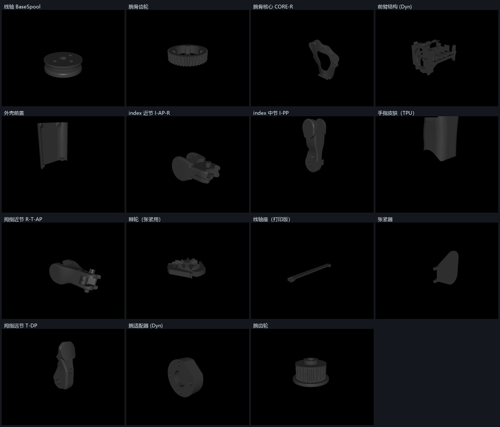

# ORCA Hand 3D 打印建造方案

目标：造一只**能被 [`orca-link/`](../orca-link/) 遥操作管线驱动的真手**——也就是我们已经在
MuJoCo 里跑通的那只手的物理版本。

论文口径（[arXiv:2504.04259](https://arxiv.org/abs/2504.04259)，IROS 2025）与官方现行规格：

| 指标 | 论文（v2.0，2025-04） | 官网现行（v2.1，2026） |
|---|---|---|
| 自由度 | **17**（腱驱动，含触觉集成） | 17 |
| 装配时间 | **< 8 小时**（假设零件齐备） | — |
| 材料成本 | **< 2000 CHF** | — |
| 耐久 | **> 10000 次循环 ≈ 20 小时**无故障 | **额定 200,000 次循环** |
| 腱绳接触面 | 无 PTFE（v2.0） | **只接触金属与光滑 PTFE，不碰 PLA** |
| 线轴座/张紧器 | 打印件 | **金属件** |
| 在售价格 | — | base **from $3,500** / touch **from $6,100** |

---

## 0. 先做一个决策：自己造，还是买成品

官方在售两个型号（[orcahand.com](https://www.orcahand.com/) 定价，2026 年查询）：

| 型号 | 配置 | 价格 |
|---|---|---|
| **1100 · orcahand v2.1 base** | 17 DoF，**无**触觉、**无**关节位置传感 | **from $3,500** |
| **2100 · orcahand v2.0 touch** | 17 DoF + **351 个触觉点**（TS） | **from $6,100** |

对照自造：论文口径材料成本 **< 2000 CHF**（≈ $2,300）。

**所以自造省的是大约三分之一到一半的钱，代价是**：数天打印机时 + 采购长尾 + 装配与标定
（官方口径 <8 h，但那是在零件齐备且有装配视频的前提下）+ 公差风险。

- **想要"尽快有一只手做研究"** → 买 1100。$3,500 换掉的是你几周的采购与试错。
- **想要"这只手是我造的"、或预算受限** → 按本方案自造，但务必走 §3 的 Gate 流程。
- **折中**（我推荐）：先按 §3 只打印 + 干装，把公差和零件可获取性摸清，再决定要不要继续。
  打印成本只有几十块耗材，却是唯一能提前暴露风险的动作。

> 仓库里的文件对应的是 **v2.1 / 1100**（3MF 名为 `Prints-1100`，
> `ASSEMBLY_ADDENDUM` 里也按 "V1100" 描述线轴），与在售型号同代。

---

## 1. 先看三个决定可行性的事实

这三点会直接改变你的执行路线，先说清楚再谈步骤。

### ① 仓库里**没有机械 BOM**

`orcahand_hardware` 只有：
- `orca_v2/electronics/ORCA_Motor_Connectors_BOM.xls`（**仅电子件**：电机接线板）
- Gerber 文件 + `How-to-order-PCB.txt`（指向 EasyEDA 下单流程）

**紧固件、销、轴承、PTFE 管、腱绳、弹簧、硅胶——一个清单都没有。**

但官方把 BOM 放在**网站上**，不在仓库里：

- **<https://www.orcahand.com/bill-of-materials>** ← 官方 BOM 页
- **官方 Discord**：<https://discord.gg/xvGyxaccRa> —— 官网原话：
  *"BOM, assembly and the rest live in Discord, with us and other builders. **Not email.**"*

> 这是本方案**最大的执行风险**：不是"能不能打印"，而是"买不齐零件"。
> 先把 `/bill-of-materials` 页和 Discord 里的清单拿到手，再开始采购。

### ② 有 CNC 机加工件

`orca_v2/base/06_CNC/`：`SpoolHolder_CNC.step` 与 `FrankaConnector.step`，各带技术图纸 PDF。

这不是可选项——官网明确写 v2.1 的改进之一就是
**"metal spool holders: Spool holders and tensioners are metal in v2.1, printed in v2.0"**。
也就是说 v2.0 可以打印这些件，**v2.1 用的是金属件**。

已确认的材料/规格（来自图纸本身）：

| 件 | 图纸信息 |
|---|---|
| `FrankaConnector` | **MATERIAL: Aluminium 6061-T6**；2× **M4×0.7**-6H 通孔；2× **M5×0.8**-6H 通孔；4× **M3×0.5**-6H 深 5 mm（图纸 Rev. 01.09.2025） |
| `SpoolHolder_CNC` | 尺寸 113.28 / 91.73 / 68.58、Ø4、Ø3.4；**图纸文本中未标注材料**（材料未确认） |

同一条官网说明还提到：**v2.1 里腱绳只接触金属与光滑 PTFE，永不接触 PLA**（v2.0 没有 PTFE）。
PTFE 管在这版里是**功能性必需件**，不是可省的细节。


### ③ 成本几乎全在 17 个舵机

型号来自 **orca_core 仓库**（`constants.py` 与 `dynamixel_client.py`；论文全文**未点名任何舵机型号**）：

| 家族 | 腕（×1） | 指（×16） |
|---|---|---|
| Dynamixel | **XC430-T240BB-T** | **XC330-T288-T** |
| Feetech | **HLS3930** | **HLS3915** |

两家族价差很大，**选型直接决定预算量级**。

⚠️ **纠正一个容易踩的误解：选型必须在打印前定，不能晚于打印。**
官方 README 说"盘 1 或盘 2 只是塔身不同"，但实际 STL 里**有 9 个零件是家族专属的**：

| 家族专属零件 | Dynamixel | Feetech |
|---|---|---|
| 腕结构 `WristStructure_*` | ✅ **13.3 MB** | ✅ 13.3 MB |
| 腕适配器 `WristAdapter_*` | ✅ | ✅ |
| 前臂结构 `ForeArmStructure_*` | ✅ | ✅ |
| 后壳 `HullBack*` | ✅ | ✅ |
| 风扇罩 `FanCover_Feetech 15.20.33` | — | ✅ |

**光 `WristStructure` 一个就是 13.3 MB 的 STL**（属于打印时间最长的件之一）。
打错家族等于白扔十几个小时机器时间——**先定家族，再开打印**。

Dynamixel 路线还需 **U2D2 + Power Hub Board（PHB）+ 12V 电源**
（`orca_core/docs/.../setting-up-dynamixels.md` 逐字：Protocol 2.0、Baudrate 57600 与 3Mbps、
ID 范围 0–17）。**电源电流规格官方未给**。

---

## 2. 变体选型

型号编号与在售目录对应：**1100 = v2.1 base**（本方案首选），**2100 = v2.0 touch**。

| 选项 | 内容 | 对应在售 | 建议 |
|---|---|---|---|
| **v2 Base**（`Prints-1100.3mf`） | 98 个 STL（60 手部 + 38 模具）、已排好盘的 Bambu 3MF | **1100**，17 DoF 无传感 | ✅ **首选**：文档、3MF、装配视频齐全，也是我们软件栈验证过的配置 |
| v2 Touch（`Prints-2100.3mf`） | 指尖加触觉，需额外 Paxini 传感器 + 板子 | **2100**，351 taxels | 后续升级 |
| v2 lite | 只有 23 STL / 18 STEP，**无 3MF、无文档** | 无 | 备选；零件少但等于自己当第一个吃螃蟹的人 |
| joint-sensing | `PrintsJointSensing.3mf` | 无（加装） | 需要关节编码器闭环时再上 |

**推荐起点：v2 Base + motor-only**。原因：我们验证过的软件路径正是 motor-only
（`load_hand(config_path="models/v2/orcahand-right/config.yaml")` → `OrcaHand`），
触觉与关节编码器都是**可后加的升级**，不必一开始就压上。

---

## 3. 阶段 0：先验证，再花钱（最重要的一步）

不要一次买齐 17 个舵机。按这个顺序：

1. **只打印，不买电机**：先打 1 根手指 + 腕骨 + 线轴
2. **干装（dry-fit）**：销、轴承、PTFE 管能不能按图纸压入？
3. 公差过关 → 再打全套 → 再买舵机

理由：FDM 公差是这类腱驱动手最常见的翻车点。销孔小 0.1mm 就要重打 60 个零件，
而这在买完舵机之后才发现会很痛。

---

## 4. 打印

```bash
git clone https://github.com/orcahand/orcahand_hardware.git   # 约 850 MB
```

用 **Bambu Lab Studio** 打开 `orca_v2/base/Prints-1100.3mf`——官方已排好盘并带打印参数。
非 Bambu 机型：从 `01_Fingers` / `02_Carpals` / `03_Wrist` / `04_ForeArm` / `05_Spools` /
`09_Skin` 里取 STL 自己排盘（STEP 源文件同名附带）。

| 部位 | STL 数 | 体积 |
|---|---|---|
| 01_Fingers | 16 | 13.2 MB |
| 02_Carpals | 9 | 35.9 MB |
| 03_Wrist | 7 | 28.9 MB |
| 04_ForeArm | 15 | 3.4 MB |
| 05_Spools | 4 | 1.0 MB |
| 09_Skin | 9 | 6.0 MB |
| **手部小计** | **60** | **88.4 MB** |
| 07_Molds（模具，仅硅胶路线需要） | 38 | 40.9 MB |

> 60 个里有 **9 个是舵机家族专属**（见 §1③），**打印前必须先定家族**。

### 这些零件长什么样

下面这张对照图是我把 15 个代表性零件从仓库拉下来、用 MuJoCo 渲染器实拍的
（脚本：[orca-link/render_parts.py](../orca-link/render_parts.py)）：



几个和装配直接相关的观察：

- **`BaseSpool` / `WristTeeth` 是带齿的线轴**，腱绳就绕在上面——这也是"张力靠棘轮拧线轴"
  的原因。`ASSEMBLY_ADDENDUM` 提到 **V1100 的线轴是 4 个螺钉孔**（V1000 是 5 个），看图时别认错
- **`Ratchet` 是个薄片**，就是官方让你用来拧线轴的张紧工具，随件打印
- **`CORE-R` 是镂空的腕骨核心**，32 条 PTFE 通道就在这类件上
- **`WristStructure_*` 是体积最大的结构件**（13.3 MB STL），家族专属
- **`SpoolHolder`（打印版）在 v2.1 已被金属件取代**——仓库里同时给了
  `04_ForeArm/SpoolHolder.stl`（打印）与 `06_CNC/SpoolHolder_CNC.step`（机加工）

### 材料分配

| 材料 | 零件 |
|---|---|
| **PLA**（结构） | 手指、腕骨、腕、前臂、线轴等绝大部分 |
| **TPU ~85A**（软） | `09_Skin/*`（9 个皮肤）+ `02_Carpals/L·R-Carpals_Skin_TPU`（2 个腕骨软皮） |
| **硅胶 Dragon Skin 10 NV** | 替代上一条的皮肤（官方推荐：抓握更好、更耐久） |

皮肤两选一：**TPU 直打（快，3MF 已含 `(TPU)` 盘）** 或 **硅胶浇注**。
硅胶路线要额外打印模具（`SiliconeMolds-1100.3mf`，其中一块用 ~85A 软 TPU）+ 硅胶 + 脱泡。

### 用拓竹 A1 打印要注意什么

官方参数取自 **BambuStudio 仓库的机器配置**（`resources/profiles/BBL/machine/`），
不是二手资料：

| 参数 | A1 | A1 mini |
|---|---|---|
| `printable_area` | **0x0 → 256x256** | 0x0 → 180x180 |
| `printable_height` | **256** | 180 |
| `printer_structure` | **i3（床动式）** | i3 |
| 可选喷嘴 | 0.2 / 0.4 / 0.6 / 0.8 | 同 |
| `auxiliary_fan` | **0（无辅助风扇）** | 0 |

#### ① 尺寸：完全不是问题

我实测了 18 个零件（含体积最大的 4 个）的包围盒：

| 零件 | 尺寸 (mm) |
|---|---|
| **ForeArmStructure** | 88.0 × **122.1** × 91.0 ← 最大单边 |
| **HullFront** | 22.0 × 93.0 × **110.1** ← 最高 |
| L/R-Carpals | 91.9 × 38.0 × 96.0 |
| WristStructure | 96.0 × 93.0 × 46.5 |
| I-PP | 19.0 × 18.0 × 54.5 |

**18 个全部 A1 放得下，也全部 A1 mini 放得下**（最大 122.1 mm vs 256 / 180）。
换机器不需要切件或分件打印。

#### ② ⚠️ 官方排盘是按 X1/P1 排的，A1 要让切片器重查避让

A1 配置里这几项是**挤出头碰撞约束**，而 X1/P1 是 CoreXY、A1 是床动式，两者间隙不同：

```
extruder_clearance_max_radius : 73
extruder_clearance_dist_to_rod: 56.5   （对象高于 extruder_clearance_height_to_rod: 25 时生效）
head_wrap_detect_zone         : 226x224 / 256x224 / 256x256 / 226x256
```

也就是说：**高件之间、以及高件与边缘之间，A1 要求的最小间距与 X1/P1 不同**。
打开官方 3MF、把机型切成 `Bambu Lab A1 0.4 nozzle` 后，**务必让 Bambu Studio 重新做一次
排盘检查**（它会给出"间距不足"的提示并按需自动重排），不要直接沿用原来的摆位。
本方案里 `HullFront`（110 mm）、`ForeArmStructure`（91 mm）、`CORE-R`（67 mm）、
`I-PP`（55 mm）都超过 25 mm 阈值，属于受约束的件。

#### ③ TPU 必须走外置料盘，不能走 AMS

BambuStudio 里 TPU 的配置是**两套分开的**：
`Bambu TPU 95A @BBL A1` 与 `Bambu TPU for AMS @BBL A1`——后者是专门为 AMS 做的硬一些的料。
普通 TPU（以及 ORCA 需要的 **~85A**，比官方 90A 还软）**只能外置料盘 + 直驱**，慢速打印。

因此 `(TPU)` 盘和 PLA 盘要**分两次任务**打，中间手动换料；
或者干脆不买 AMS（ORCA 全是单色 PLA，AMS 只省换料，不是必需）。

#### ④ 开放式机型 → 只打 PLA/PETG/TPU

ORCA 官方用 PLA（eSUN），正好是 A1 的强项。**别换 ABS/ASA**——A1 没有恒温腔，
必然翘边。大面积件（`L/R-Carpals` 92×96、`ForeArmStructure` 122×91）建议**加 brim**、
擦净 PEI 板。

#### ⑤ 换机器后必须重新切片

3MF 里带的是原机器的配置，**不能沿用**。流程：Bambu Studio 打开
`Prints-1100.3mf` → 机型选 `Bambu Lab A1 0.4 nozzle` → 选一个 A1 的 process 配置
（如 `0.20mm Standard @BBL A1`）→ 重新切片。

#### ⑥ 公差件：先用 0.4，不够再上 0.2

A1 支持 0.2 喷嘴。但**先别急着换**——按 §3 的阶段 0 用 0.4 打样品干装，
量出销孔/轴承孔实际偏多少，再决定是换 0.2 喷嘴还是扩孔/铰孔。
v2.1 的卖点之一就是 "improved tolerances"，说明官方也在意这个。

#### ⑦ 时间预期

60 个 PLA 件 + 9 个 TPU 件（88 MB STL）。床动式机型速度不如 CoreXY，
按官方"装配 <8 h"的前提是**零件已经打好**，所以**打印机时是数天量级**，
建议分批打（先手指+腕骨，验证公差后再打大的）。

---

## 5. 采购清单

**可以现在确定的部分：**

- **舵机 ×17**：16 指 + 1 腕，按 §1③ 选家族
- **腱绳**：**Ø0.4 mm 尼龙编织绳**（论文原文 "two fishing lines (Nylon fibers braided into a
  0.4 mm diameter rope)"），**每个关节 2 根**（flexor + extensor，腕除外）
- **驱动/接口**：
  - v2 手自带的 **ORCA controller board** → Windows 上免驱，显示为两个 `USB Serial Device (COMx)`
  - 若用 U2D2（Dynamixel 路线）：还需 **Power Hub Board + 12V 电源**
  - Feetech 路线：CH340 或 CP210x 适配器
- **电机接线板 PCB**：用 `electronics/ORCA_Motor_Connectors_Gerber` 走 EasyEDA 打样
  （BOM 里只有 1 行物料：`PM254V-11-03-H85`，JLCPCB 料号 `C541850`）
- **PTFE 管**：每指 AP 2 根（**长 8–10 mm**，两端各留 ~1 mm）；腕骨 **32 根**；塔身 **32 根**
- **销**：拇指 AP 用 **2×30** ×2；腕关节用 **3×50**（3×45 勉强可用）×2
- **轴承**：拇指 AP 用 **4×8×3**；腕轴两端各一个 **8×13×4**
- **M4 螺钉**：塔身用，外面套 PTFE 管
- **硅胶**（做硅胶皮肤时）：官网指名 **Dragon Skin 10 NV**（Smooth-On）
- **PLA**：官网指名 **eSUN**。官网原话："You supply the PLA and silicone yourself.
  These are the exact materials we use."

**仍需自行补全的部分**：螺丝/弹簧/磁铁的完整数量与规格、硅胶硬度以外的浇注工艺参数。

> 官方 v2 BOM（**含数量与采购说明**）在这个 Google Sheets：
> <https://docs.google.com/spreadsheets/d/1KuzqoXPn165d440Sw2QLM02ne0wbVuQrWCZv1HRueVI/edit>
> （我在本机**打不开** `docs.google.com`，连接超时——需要你在能访问 Google 的网络打开。）
> v1 legacy 的 BOM 另附**价格、采购链接与运费估算**：<https://www.orcahand.com/legacy/files>

⚠️ **注意**：官网明确写 **"orcahand touch is open-source; its tactile sensing module
remains proprietary"**——触觉模块不开源。想做 2100 touch 的**自造**版本，这一块拿不到设计；
这也是把 base 作为起点的又一个理由。

> 我**不编造**逐项价格。论文全文**没有成本表**（只有一个关节活动范围表），
> 唯一的总量数字是论文的 <2000 CHF 与官网的 $3,500/$6,100。

---

## 6. 装配顺序

⚠️ 官方装配视频有若干处**已过期**，`orca_v2/base/ASSEMBLY_ADDENDUM.md` 是修正版。
下面把修正合并进来了（时间戳指视频）：

1. **每指 AP 打 PTFE**（视频 7:50）：宽孔对的两个孔各插一根，两端各留 ~1 mm
2. **拇指 AP**（21:04）：新件是**一条长缝**、不是 6 个孔 → 先按视频顺序把腱穿进长缝
   （顺序错了会交叉），再插 2 根 2×30 销，最后上 4×8×3 轴承
3. **腕骨**（25:05）：**32 个通道**各插一根 PTFE；穿腱；把 5 指装到腕骨上
4. **腕关节与齿轮**（31:59）← **视频里缺这一步**：插 2 根 3×50 销；装 3D 打印的腕骨齿轮；
   腕轴两端各装一个 8×13×4 轴承
5. **塔身**（40:50 / 39:50）：**32 个通道**插 PTFE；M4 螺钉套 PTFE 时，
   一手压紧、用螺丝刀把它"拧进"管子，比硬压容易
6. **线轴**（53:30）：**V1100 的线轴是 4 个螺钉孔**，V1000 是 5 个——别混
7. 最难的一步是往细长弯曲通道里塞 PTFE：把一根打了结的腱先穿过 PTFE，
   再用它把管子**拉**进通道，而不是推

---

## 7. 张力与标定（官方流程，必须循环做）

1. `python scripts/tension.py <config.yaml>`
   默认先自动绕紧腱绳 → 锁住舵机 → 固定底部线轴。`--no-move-motors` 可只保持当前位置
2. 用随件打印的**棘轮**，顺时针拧**每个舵机的上线轴**
   拧的时候应该听到/感到**"咔哒"**声——这表示棘轮啮合、正在上张力
3. ⚠️ **极容易过紧**。只拧到腱绳"有张力感"就停，**不是越紧越好**；过紧会直接损害性能
4. `python scripts/calibrate.py <config.yaml>` 跑全套关节标定
5. **重复 2↔4 一到两次**，直到标定结束后**不再出现新的松弛**
   （初次装配因为手工绕线，松弛会很多，标定一开始"看起来没效果"是正常的）
6. `python scripts/measure_travel.py <config.yaml>` 生成这只手**自己的**
   `joint_motor_travel` 基线 —— 每只手的腱路由都不同，**不要抄别人的数字**

---

## 8. 软件接入（我们已有的部分直接可用）

### Windows 首次连接清单

1. `uv run pytest` 通过
2. 插上手：`python -m serial.tools.list_ports -v` 能看到 COM 号，设备管理器无黄色感叹号
   - v2 自带控制板：Windows 免驱，会出**两个** COM 口（电机总线 + 传感链路）
   - **U2D2 用户注意**：设备管理器 → 端口 → 属性 → 端口设置 → 高级 →
     **Latency Timer 改成 1 ms**（这个设置 Windows 上不会自动改，不改的话控制频率上不去）
3. `python scripts/detect.py` 应能自动认出端口和舵机家族（问你要选端口时是数字列表，正常）
4. `python scripts/configure_motor_chain.py <config.yaml>` 配置电机链
5. **端口是独占的**：另一个程序占着 COM 口会直接 `PermissionError`，关掉串口监视器等再试

### 接到我们的遥操作管线

```powershell
# 先用仿真确认输入正常（不碰硬件）
<conda env>\python.exe orca-link\teleop_live.py --drive sim --sim-render human
<conda env>\python.exe orca-link\orca_bridge.py --sink grpc
<conda env>\python.exe orca-link\drive_gestures.py --pattern wave --seconds 0

# 确认无误后换真机
<conda env>\python.exe orca-link\teleop_live.py --drive real
```

`--drive real` 会走真实的 `load_hand()` → `connect()` → `init_joints()`，
再由官方 `pipeline.run()` 把重定向后的关节角下发。**先空载、低电流、小幅度试**。

---

## 9. 时间与预算

| 项目 | 估计 | 依据/不确定性 |
|---|---|---|
| 下载仓库 | 850 MB | 实测 |
| 打印 | 60 个手部零件 + 38 模具 | 单件 1–3 h 视机型 → 数天打印机时（**估算**） |
| **CNC 铝件** | SpoolHolder + FrankaConnector | 需询价；v2.1 的金属线轴座是**必需件** |
| 装配 | **< 8 h** | 论文口径，假设零件齐备 |
| 张力+标定 | 数小时（要循环 2–3 轮） | 官方流程 |
| 材料成本 | **< 2000 CHF** | 论文口径；**舵机选型是最大变量** |
| 对照：买成品 | **$3,500**（base）/ **$6,100**（touch） | 官网定价，2026 年查询 |

> 我**不编造**逐项价格。论文全文**没有成本表**（我逐字核过：全文唯一表格是关节活动范围表，
> `CHF|USD|price|cost|BOM` 均无逐项数字），唯一可靠的两个总量数字是论文的 <2000 CHF
> 与官网的 $3,500/$6,100；**舵机家族选型是最大变量**，其余按 §5 清单逐项询价。
> 带数量与采购说明的官方 v2 BOM 在 §5 给出的 Google Sheets 里。

---

## 10. 风险与检查点（每个 Gate 不过就别往下走）

| Gate | 检查什么 | 不过怎么办 |
|---|---|---|
| **G1 打印公差** | 销与轴承能按图纸压入（先干装 1 根手指） | 调补偿/换打印机，别买舵机 |
| **G2 零件齐备** | §5 清单全部到位（尤其腱绳与紧固件） | 转向官方套件 |
| **G3 电机链** | 17 个 ID 唯一、波特率一致、`detect.py` 全认出 | 用 `configure_motor_chain.py` 重配 |
| **G4 空载单指** | 单指能跟随小幅度指令 | 查腱路由与张力，别整手穿腱 |
| **G5 标定收敛** | 张力↔标定循环后不再出现新松弛 | 继续循环；仍不收敛查是否过紧/腱绳打滑 |
| **G6 首次整手运动** | 低电流 + 小步长 + 手边有断电手段 | 立即停 |

论文的"<8 小时装配"是在**零件齐备、有装配视频**的前提下。真正的长尾在 §5 的采购和 G1/G2。

---

## 11. 最难的地方在哪（不是舵机）

容易被误判的一点：**17 个舵机是最贵、最标准化的部件，但不是最难的**。
它们是从货架商品，有官方配置向导，`orca_core` 还会自动探测家族与端口。
真正吃时间、也最容易翻车的是下面三件。

### 第一名：腱绳路由与张力（真正的"手艺"）

- **通道数量**：腕骨 **32** 条、塔身 **32** 条、每指 AP **2** 条，全部要塞 PTFE 管并把两端
  修到只露出 ~1 mm（`ASSEMBLY_ADDENDUM.md`）
- **塞管本身就是个技术活**：官方专门给了技巧——把一根打了结的腱先穿过 PTFE，
  再用它把管子**拉**进通道，而不是推（推不进去）
- **顺序不能错**：拇指 AP 是"先按视频顺序把腱穿过长缝，再插销、上轴承"，
  顺序错了腱会交叉
- **张力有个甜蜜点**：官方原话是"只拧到腱绳**有张力感**为止"，并明确警告
  **极易过紧**；过紧是文档里写明的故障模式，`orca_core` 甚至为此专门做了机制
  （`calibration_travel_margin` / `calibration_max_current` / `calibration_retry_current=1.5×`），
  描述就是"**the fix for an over-tensioned hand whose joints stall before their hardstops**"
- **必须循环**：`calibrate → tension` 重复 **1–2 次**，直到标定后不再出现新松弛。
  初次装配因手工绕线，松弛会很多，标定一开始"看起来没效果"是正常的
- **重穿是常规维护**：官网原话"rated for 200,000 cycles, **then you restring it and start again**"

### 第二名：采购与配套（最容易被低估）

仓库里**没有机械 BOM**，官方 BOM 是一张 Google Sheets。缺一个规格、买错一个直径，
整只手就停在那里等快递。见 §1① 与 §5。

### 第三名：打印公差

销与轴承要能压入。官网把 v2.1 的改进点之一写成 **"improved tolerances, no knot slipping"**——
反过来说 v2.0 在这上面吃过亏。这就是 §3 阶段 0 存在的理由：
**先只打印、干装，公差过关再买舵机。**

### 那舵机什么时候会成为难点？

只在三个具体场景：

1. **花钱的时候**——它是预算的主项（见 §9）
2. **配 ID 与波特率时**——17 个 ID 必须唯一，得一个一个接上去设；Dynamixel 还要
   把 U2D2 的 **latency timer 手动改成 1 ms**（Windows 上不会自动设）
3. **过紧的代价会算在它头上**——腱绳过紧时关节会在硬限位之前就堵转，
   表现成"舵机没力气"，但根因在张力

### 会磨损的不是舵机，是耗材

论文的耐久测试里，先坏的都不是电机：

| 薄弱环节 | 论文数据 | 属于 |
|---|---|---|
| 铜线断裂（∅0.2mm，拇指/食指/中指） | **4,500–7,000** 次抓握循环 | **仅 touch 变体** |
| 硅胶老化（2 个指尖） | **2,000–4,000** 次循环 | 两种变体 |
| 小指触觉阈值劣化 | 升至 **6.38 N** | 仅 touch 变体 |

**推论**：base 变体没有那些铜线，直接绕开了一个已知失效模式——这也是从 base 起步的
又一个理由。另外**腱绳、PTFE、硅胶这些耗材建议一次多买**，它们是消耗品。

> 来源标注：通道数量、张力手法、装配顺序来自 [仓库] `ASSEMBLY_ADDENDUM.md` 与本仓库文档；
> 耐久数据与"过紧"故障模式来自论文 §III-E/§IV-C 与 [仓库] `CLAUDE.md`；
> "200,000 次后重穿" 与 v2.1 改进项来自 [官网]。


## 12. 规格速查（论文逐字，可拿来验收）

装完之后可以直接照这些数字验收。全部出自论文原文，非我推断。

| 项目 | 数值 |
|---|---|
| 自由度 | **17**（5 指 + 1 可动手腕） |
| 重量 | 约 **1.2 kg**，尺寸接近成年人手 |
| 抓握负载 | 四指 **10.5 kg（103 N）**；仅食指 **2 kg（19.6 N）**（测试条件：位置控制模式恒 **600 mA**） |
| 手腕 | 屈伸各 **60°**（人手约 80°），**GT2 玻纤增强同步带**传动 |
| 拇指 | 掌内旋 **15°** |
| 关节精度 | AprilTag 测角 **σ = 0.08°** |
| 端到端时延 | 平均 **< 0.2 s**（主要来自软件链路）；论文未给 Hz |
| 控制率（仓库数字） | 17 电机单总线 3 Mbaud：朴素读写 ~12 ms（**~85 Hz**），优化后 ~4.5 ms（**~224 Hz**） |
| 耐久 | 论文 **> 10000 次循环 ≈ 20 小时**；官网现行额定 **200,000 次** |
| 触觉（2100 touch） | FSR **RP-C7.6-ST**，五指指尖，**二值**（不做力幅），10 kΩ 分压 + 5V + Arduino Nano Every |

论文唯一的表格——关节活动范围（TABLE I）：

| 关节 | 第 2–5 指 屈 / 伸 | 拇指 屈 / 伸 |
|---|---|---|
| IP | — | 100° / 20° |
| PIP | 130° / 20° | — |
| MCP | 110° / 20° | 115° / 20° |
| ABD | 30° / 30° | 45° / 45° |
| CMC | — | 48° / 53° |

> 注意这是**论文 v2.0 的标称范围**；`orca_core` 里 `config.yaml` 的 `joint_roms`
> 才是装配后逐台标定、软件实际夹取用的范围，两者不必一致。

---

## 13. 参考

**官方（BOM 与采购问题优先看这里）**

- 官方 BOM 页：<https://www.orcahand.com/bill-of-materials>
- 官方 Discord（BOM/装配问题的官方渠道，官网明确说**不要用邮件**）：<https://discord.gg/xvGyxaccRa>
- 官方 Getting started：<https://www.orcahand.com/getting-started>
- 型号与配置下单：<https://www.orcahand.com/models/full> · <https://www.orcahand.com/shop/configure>

**代码与模型**

- 硬件仓库（3MF/STL/STEP，CC BY 4.0）：<https://github.com/orcahand/orcahand_hardware>
- 控制栈：<https://github.com/orcahand/orca_core> · 遥操作：<https://github.com/orcahand/orca_teleop>
- 论文（IROS 2025）：<https://arxiv.org/abs/2504.04259>
- 装配视频（配合 `ASSEMBLY_ADDENDUM.md` 看）：<https://www.youtube.com/watch?v=TgIz7HiyaoU>
- Windows 连接细节：`orca_core/docs/pages/getting-started-docs/windows.md`
- 张力与标定：`orca_core/docs/pages/getting-started-docs/initial-tensioning-and-calibration.md`

> 授权注意：硬件文件按仓库 README 声明为 **CC BY 4.0**（可商用，需署名；官网页脚单独
> 提到 v1 设计文件为 CC BY 4.0）；`orca_core` / `orcahand_description` 是 MIT；
> **`orca_teleop` 没有 LICENSE 文件**，商用前请自行确认。

