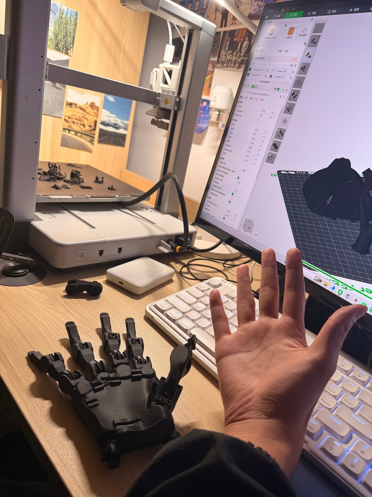
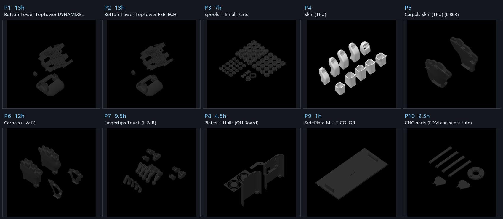
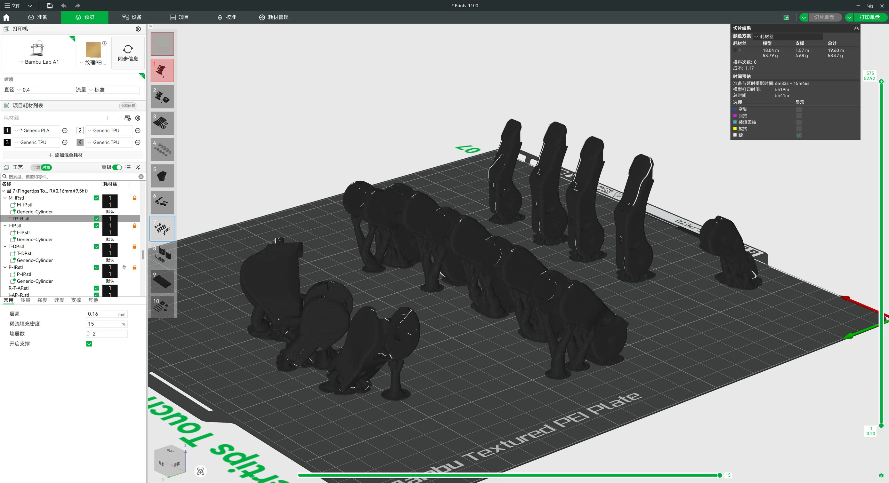

# ORCA Hand 3D 打印建造方案

目标：造一只**能被 [`orca-link/`](../orca-link/) 遥操作管线驱动的真手**——也就是我们已经在
MuJoCo 里跑通的那只手的物理版本。

论文口径（[arXiv:2504.04259](https://arxiv.org/abs/2504.04259)，IROS 2025）与官方现行规格：

| 指标 | 论文（v2.0，2025-04） | 官网现行（v2.1，2026） |
|---|---|---|
| 自由度 | **17**（腱驱动，含触觉集成） | 17 |
| 装配时间 | **< 8 小时**（假设零件齐备） | — |
| 材料成本 | **< 2000 CHF** | — |
| 耐久 | **> 10000 次循环 ≈ 20 小时**无故障 | **额定 200,000 次循环** |
| 腱绳接触面 | 无 PTFE（v2.0） | **只接触金属与光滑 PTFE，不碰 PLA** |
| 线轴座/张紧器 | 打印件 | **金属件** |
| 在售价格 | — | base **from $3,500** / touch **from $6,100** |

---

## 0. 先做一个决策：自己造，还是买成品

官方在售两个型号（[orcahand.com](https://www.orcahand.com/) 定价，2026 年查询）：

| 型号 | 配置 | 价格 |
|---|---|---|
| **1100 · orcahand v2.1 base** | 17 DoF，**无**触觉、**无**关节位置传感 | **from $3,500** |
| **2100 · orcahand v2.0 touch** | 17 DoF + **351 个触觉点**（TS） | **from $6,100** |

对照自造：论文口径材料成本 **< 2000 CHF**（≈ $2,300）。

**所以自造省的是大约三分之一到一半的钱，代价是**：数天打印机时 + 采购长尾 + 装配与标定
（官方口径 <8 h，但那是在零件齐备且有装配视频的前提下）+ 公差风险。

- **想要"尽快有一只手做研究"** → 买 1100。$3,500 换掉的是你几周的采购与试错。
- **想要"这只手是我造的"、或预算受限** → 按本方案自造，但务必走 §3 的 Gate 流程。
- **折中**（我推荐）：先按 §3 只打印 + 干装，把公差和零件可获取性摸清，再决定要不要继续。
  打印成本只有几十块耗材，却是唯一能提前暴露风险的动作。

> 仓库里的文件对应的是 **v2.1 / 1100**（3MF 名为 `Prints-1100`，
> `ASSEMBLY_ADDENDUM` 里也按 "V1100" 描述线轴），与在售型号同代。

---

## 1. 先看三个决定可行性的事实

这三点会直接改变你的执行路线，先说清楚再谈步骤。

### ① 仓库里**没有机械 BOM**

`orcahand_hardware` 只有：
- `orca_v2/electronics/ORCA_Motor_Connectors_BOM.xls`（**仅电子件**：电机接线板）
- Gerber 文件 + `How-to-order-PCB.txt`（指向 EasyEDA 下单流程）

**紧固件、销、轴承、PTFE 管、腱绳、弹簧、硅胶——一个清单都没有。**

但官方把 BOM 放在**网站上**，不在仓库里：

- **<https://www.orcahand.com/bill-of-materials>** ← 官方 BOM 页
- **官方 Discord**：<https://discord.gg/xvGyxaccRa> —— 官网原话：
  *"BOM, assembly and the rest live in Discord, with us and other builders. **Not email.**"*

> 这是本方案**最大的执行风险**：不是"能不能打印"，而是"买不齐零件"。
> 先把 `/bill-of-materials` 页和 Discord 里的清单拿到手，再开始采购。

### ② 有 CNC 件，但**官方明确给了 FDM 替代**

`orca_v2/base/06_CNC/`：`SpoolHolder_CNC.step` 与 `FrankaConnector.step`，各带技术图纸 PDF。
官网也写了 v2.1 的改进之一是
**"metal spool holders: Spool holders and tensioners are metal in v2.1, printed in v2.0"**。

⚠️ **但这不是拦路虎**——我解包官方 `Prints-1100.3mf` 后发现，**盘 10 的名字就叫
`CNC parts (FDM can substitute)`，官方工时 2.5 小时**。也就是说官方把 CNC 件的
**可打印替代版本**直接放进了打印工程里。你可以选择机加工（更耐久），也可以直接打（2.5h）。

已确认的材料/规格（来自图纸本身）：

| 件 | 图纸信息 |
|---|---|
| `FrankaConnector` | **MATERIAL: Aluminium 6061-T6**；2× **M4×0.7**-6H 通孔；2× **M5×0.8**-6H 通孔；4× **M3×0.5**-6H 深 5 mm（图纸 Rev. 01.09.2025） |
| `SpoolHolder_CNC` | 尺寸 113.28 / 91.73 / 68.58、Ø4、Ø3.4；**图纸文本中未标注材料**（材料未确认） |

同一条官网说明还提到：**v2.1 里腱绳只接触金属与光滑 PTFE，永不接触 PLA**（v2.0 没有 PTFE）。
PTFE 管在这版里是**功能性必需件**，不是可省的细节。


### ③ 成本几乎全在 17 个舵机

型号来自 **orca_core 仓库**（`constants.py` 与 `dynamixel_client.py`；论文全文**未点名任何舵机型号**）：

| 家族 | 腕（×1） | 指（×16） |
|---|---|---|
| Dynamixel | **XC430-T240BB-T** | **XC330-T288-T** |
| Feetech | **HLS3930** | **HLS3915** |

两家族价差很大，**选型直接决定预算量级**。

⚠️ **纠正一个容易踩的误解：选型必须在打印前定，不能晚于打印。**
官方 README 说"盘 1 或盘 2 只是塔身不同"，但实际 STL 里**有 9 个零件是家族专属的**：

| 家族专属零件 | Dynamixel | Feetech |
|---|---|---|
| 腕结构 `WristStructure_*` | ✅ **13.3 MB** | ✅ 13.3 MB |
| 腕适配器 `WristAdapter_*` | ✅ | ✅ |
| 前臂结构 `ForeArmStructure_*` | ✅ | ✅ |
| 后壳 `HullBack*` | ✅ | ✅ |
| 风扇罩 `FanCover_Feetech 15.20.33` | — | ✅ |

**光 `WristStructure` 一个就是 13.3 MB 的 STL**（属于打印时间最长的件之一）。
打错家族等于白扔十几个小时机器时间——**先定家族，再开打印**。

Dynamixel 路线还需 **U2D2 + Power Hub Board（PHB）+ 12V 电源**
（`orca_core/docs/.../setting-up-dynamixels.md` 逐字：Protocol 2.0、Baudrate 57600 与 3Mbps、
ID 范围 0–17）。**电源电流规格官方未给**。

#### 有更便宜的舵机替代吗？有三档，差别在"要不要写代码"

| 档 | 方案 | 省多少 | 代价 |
|---|---|---|---|
| **一** | **Feetech HLS3915 / HLS3930**（官方支持） | 相对 Dynamixel 约省一半 | **零代码**：打盘 2 的塔身 + Feetech 专属件（见上表），`motor_type` 自动探测 |
| 二 | Feetech **STS/SCS 系列**（如 STS3215，明显更便宜） | 再省一些 | **要写新的 `MotorClient`**，见下 |
| 三 | N-B-Studio fork 的 **SCS-225/ST3215** 路线 | 同档二 | 仓库里已有半成品（`scs225_client.py` 339 行 + `dual_scs225_client.py` + `orcahand-scs225-right/config.yaml`），但**装不上也加载不了** |

**档一就是答案**：这是唯一"官方支持、只改打印内容、不动代码"的降本路径。
orca_core 的型号映射里本来就写着 `HLS3930`（腕）/ `HLS3915`（指），
`motor_type` 也是连接时自动探测的，所以换家族只是换一套 STL。

**档二/档三为什么难**——orca_core 的 Feetech 支持是**硬绑 HLS 寄存器表**的：

- `feetech_client.py` 只 `from .feetech_registers import HLS`，全部地址走 `HLS.*`；
  型号映射只有 `4106: HLS3930`、`6922/5130: HLS3915`
- 它用的 `HLSPacketHandler` 注释写的是 "**little-endian registers, no family helpers**"
  ——即 HLS 是**小端**；而 Feetech 经典 STS/SCS 协议是**大端**，所以**不能只改配置就接上**
- 好消息：vendored SDK 里**已经带了** `scscl.py`（SCS 系列）与 `sms_sts.py`（STS 系列），
  也就是"能通信"，缺的是上层客户端的寄存器映射与包处理器

我实测确认了 fork 那条路是断的：
`OrcaHandConfig.from_config_path(".../orcahand-scs225-right/config.yaml")`
→ `HandConfigValidationError: Unknown motor_type: 'scs225'`，
因为 fork 只加了两个 client 文件，**没动** `constants.py` 的 `SUPPORTED_MOTOR_TYPES`
（仍是 `['dynamixel','feetech']`）也没动 `motor_factory.py`（grep 零 scs 引用），
那两个 client 没有任何东西 import。

**换便宜舵机时绝不能破坏的四件事**（这才是真正的成本）：

1. **腕需要多圈位置模式**——`control_mode` 里专门为腕准备了 `multi_turn_position`；
   不支持多圈的舵机做不了腕的收线与 60° 行程
2. **硬限位自动标定**——ORCA 的招牌能力。它把每个关节驱到硬限位、靠**堵转/电流**判定，
   所以 `calibration_current`、`MIN_MOTOR_TRAVEL_RAD`、`calibration_retry_current` 才有意义。
   **便宜的、电流反馈不可靠的舵机做不了这个**，等于 17 个关节改手工标定
3. **扭矩与张力**——代码注释写明 `HLS3915 fingers stall at 1.5 A`，
   而整手要能四指抓 10.5 kg。扭矩不足会顶不住腱绳张力
4. **总线一致性**——同一波特率菊花链、17 个唯一 ID，且 `motor_resolution` 靠 ping 厂商 ID
   探测；新家族必须加进探测逻辑

> 结论：**要省钱就走档一（Feetech HLS）**，改打印不改代码。
> 再往下省的那点钱，要用"写并验证一个新的电机客户端 + 重调标定"来换，
> 而且立刻失去硬限位自动标定——相对 17 个舵机的总价，这笔账通常不划算。
> （论文给的对照也说明 ORCA 已在便宜档：Shadow >100,000 CHF、Allegro ≈15,000 CHF、LEAP <2,000 CHF。）

---

## 2. 变体选型

型号编号与在售目录对应：**1100 = v2.1 base**（本方案首选），**2100 = v2.0 touch**。

| 选项 | 内容 | 对应在售 | 建议 |
|---|---|---|---|
| **v2 Base**（`Prints-1100.3mf`） | 98 个 STL（60 手部 + 38 模具）、已排好盘的 Bambu 3MF | **1100**，17 DoF 无传感 | ✅ **首选**：文档、3MF、装配视频齐全，也是我们软件栈验证过的配置 |
| v2 Touch（`Prints-2100.3mf`） | 指尖加触觉，需额外 Paxini 传感器 + 板子 | **2100**，351 taxels | 后续升级 |
| v2 lite | 只有 23 STL / 18 STEP，**无 3MF、无文档** | 无 | 备选；零件少但等于自己当第一个吃螃蟹的人 |
| joint-sensing | `PrintsJointSensing.3mf` | 无（加装） | 需要关节编码器闭环时再上 |

**推荐起点：v2 Base + motor-only**。原因：我们验证过的软件路径正是 motor-only
（`load_hand(config_path="models/v2/orcahand-right/config.yaml")` → `OrcaHand`），
触觉与关节编码器都是**可后加的升级**，不必一开始就压上。

### 能自己设计舵机吗？能，但要先看清"硬性契约"

**orca_core 对舵机的要求是刚性的**，不是"能转就行"。从 `hardware/motor_client.py`
的 `MotorClient` ABC 提出来，一个执行器必须通过总线提供：

| 类别 | 必须有的 |
|---|---|
| 读数 | 位置、速度、**电流**（← 硬限位自动标定的唯一依据，不可省） |
| 位置能力 | **多圈位置**（腕用 `multi_turn_position` 模式） |
| 上限设置 | 位置 / 速度 / 扭矩（电流）可设 |
| 模式 | `position` / `current` / `velocity` 可切 |
| 身份 | ID 与波特率可改，且能被 `probe()` / `scan_for_motors()` 探到 |
| 配置 | EEPROM 寄存器读写、硬件错误位、增益 `kp/ki/kd`、温度 |

**关键发现：协议本身极小，这是自主路线唯一现实的切入点。**
`feetech/hls.py` 全文只有 114 行，整个寄存器表就是：

```
EPROM:  MODEL=3/4, ID=5, BAUD=6, 角度上下限=9..12, CW/CCW_DEAD=26/27, OFS=31/32, MODE=33
SRAM 写: TORQUE_ENABLE=40, ACC=41, GOAL_POSITION=42/43, GOAL_TORQUE=44/45, GOAL_SPEED=46/47, LOCK=55
SRAM 读: PRESENT_POSITION=56/57, PRESENT_SPEED=58/59, PRESENT_LOAD=60/61,
         电压=62, 温度=63, MOVING=66, PRESENT_CURRENT=69/70
```

所以**你不需要"发明一个智能舵机"，你需要做一个"能被 orca_core 直接驱动的执行器"——
最省力的办法是让它的固件模仿 HLS 这套寄存器表**，这样 orca_core **零改动**。

三层野心，代价差一个数量级：

| 层 | 做法 | 难度 | 说明 |
|---|---|---|---|
| **A** | 换现成便宜总线舵机 + 写新 `MotorClient` | 中 | 见上面的档二/三 |
| **B** | 小型 BLDC + 行星减速 + 磁编码器 + FOC 驱动板，**固件模仿 HLS 协议** | 中高 | 自主路线里最实际的 |
| **C** | 从零设计电机/减速器/编码器/驱动/固件/协议全栈 | 极高 | 等于把 Dynamixel 的活重做一遍 |

**B 层有现成参考**：同组织的 **`orcahand/openarm`**（**Apache-2.0**，166 MB）就是开放执行器路线——
用 **DAMIAO** 电机（`dm4310/dm4340/dm8009` 规格书在仓库里）+ 自研驱动板 + JLCPCB 打板流程，
网站里有 BOM 与装配文档。
⚠️ 但 DM4310 是 Ø46 mm 级别，**塞不进手部塔身**；它只能当"开放执行器电子学与打板流程"的
参考，不能直接搬。

**为什么"小"才是最难的一段**：整手 1.2 kg 含 17 个电机，单电机只能 20–40 g；
但四指要抓 10.5 kg。按"指尖力 × 指长 ÷ 线轴半径"估算，关节需约 **1 N·m 量级**的扭矩
→ 必须高减速比 + 可靠的位置/电流反馈。**小型高扭矩 + 精密反馈 + 总线智能，正好是"便宜"与
"贵"的分界线。**

**建议路径**：

1. 想降本 → 走 Feetech HLS（零代码）
2. 想学 → **先只做 1 个原型**：GB2208/GB4108 云台电机 + 5–10:1 行星 + AS5600 磁编码器 +
   SimpleFOC 驱动，固件模仿 HLS 寄存器表。**验收标准是它能被 `scripts/detect.py` 认出来、
   并能跑完硬限位标定**
3. 只有 1 个原型通过了"被 orca_core 完整驱动 + 通过标定"，再做 16 个

> 诚实边界：DAMIAO / Feetech 的实际价格我无法核实（搜索服务未配 key，官网是 JS 渲染）；
> "小执行器最难"是基于尺寸/重量/扭矩约束的工程判断，非实测；
> 这条路线的时间成本我给不出可信估计——我没做过这类执行器。

---

## 3. 阶段 0：先验证，再花钱（最重要的一步）

不要一次买齐 17 个舵机。按这个顺序：

1. **只打印，不买电机**：先打 1 根手指 + 腕骨 + 线轴
2. **干装（dry-fit）**：销、轴承、PTFE 管能不能按图纸压入？
3. 公差过关 → 再打全套 → 再买舵机

理由：FDM 公差是这类腱驱动手最常见的翻车点。销孔小 0.1mm 就要重打 60 个零件，
而这在买完舵机之后才发现会很痛。

### 实际进度：G1 已走到（零件已打印 + 干装中）



进度记录（2026-07，实测）：

- ✅ **一台 Bambu Lab A1 已把首批零件打完**，盘上是成品件（支撑还在，未清理）
- ✅ **机械骨架已拼起来**：掌骨 + 4 指 + 拇指，**尚无腱绳、无舵机**
- ⬜ 待做：清理支撑 → **检查销与轴承的压入配合**（这是 G1 的核心判据）
- ⬜ 待做：PTFE 管能否按图纸塞进 32 条腕骨通道

这一阶段的判据很具体，别跳过：

| 检查项 | 通过标准 | 不过怎么办 |
|---|---|---|
| 销孔（2×30 / 3×50） | 销能**压入但不松旷**，插入后无晃动 | 孔小 → 钻孔/铰孔；孔大 → 换更粗销或补件 |
| 轴承位（4×8×3 / 8×13×4） | 轴承能压入，且不歪 | 同上 |
| PTFE 通道 | Ø 合适、管子能通到底、两端可露出 ~1 mm | 通道堵/小 → 用钻头过一遍 |
| 腱绳通道内壁 | **不应有毛刺/拉丝**（会磨断腱绳） | 修整；v2.1 的设计意图就是让腱只接触金属与 PTFE |

> 参考尺度：ORCA 的设计是"接近成年人手"，1.2 kg 含 17 个电机。
> 照片里那只手（掌+指，无电机）比真手明显轻，符合预期。

---

## 4. 打印

```bash
git clone https://github.com/orcahand/orcahand_hardware.git   # 约 850 MB
```

用 **Bambu Lab Studio** 打开 `orca_v2/base/Prints-1100.3mf`——官方已排好盘并带打印参数。

### 这 10 个盘分别是什么（官方盘名与工时，从 3MF 元数据解出）



| 盘 | 官方盘名 | 工时 | 要打吗 |
|---|---|---|---|
| **P1** | `BottomTower Toptower **DYNAMIXEL**` | **13 h** | 用 Dynamixel 就打这个 |
| **P2** | `BottomTower Toptower **FEETECH**` | **13 h** | 用 Feetech 就打这个（**二选一**） |
| **P3** | `Spools + Small Parts` | **7 h** | ✅（**0.2 mm 喷嘴**）。线轴在这里，密密麻麻几十个 |
| **P4** | `Skin (TPU)` | — | ✅ 走 TPU 皮肤时（**TPU 料**） |
| **P5** | `Carpals Skin (TPU) (L & R)` | — | ✅ 同上（**含左右手两套**） |
| **P6** | `Carpals (L & R)` | **12 h** | ✅（**0.16 mm 层高**，含左右手两套） |
| **P7** | `Fingertips Touch (L & R)` | **9.5 h** | ✅（**0.16 mm 层高**，含左右手两套） |
| **P8** | `Plates + Hulls (OH Board)` | **4.5 h** | ✅（**0.2 mm 喷嘴**） |
| **P9** | `SidePlate MULTICOLOR` | **1 h** | 可选（多色侧板，**0.2 mm 喷嘴**） |
| **P10** | `CNC parts (FDM can substitute)` | **2.5 h** | 想省机加工就打这个 |

**总工时：约 49.5 小时**（已排除 P2 备选盘，未含 P4/P5 的 TPU 盘——那两盘官方没给工时）。

从这张图能直接看出来的几件事：

- **P1 与 P2 是同一位置的两个版本**（底部塔身 + 顶部塔身），按舵机家族二选一
- **P3 上是一大片线轴**——不是只打一个
- **P4 是 10 个指尖皮肤帽，P5 是两片掌部软皮**，明显是白色/浅色（TPU 盘）
- **P6 / P7 都标了 `(L & R)`**——**同一盘含左右手两套**，你打一盘会得到两只手的件
- **P9 是一整块平板**（多色侧板）
- **P10 是 4 根杆 + 2 个泪滴形件 + 1 个环**，就是 CNC 件的打印替代版

#### 每盘到底装了哪些零件（从 3MF 元数据解出，非猜测）

| 盘 | 零件清单 |
|---|---|
| **P1** | `ForeArmStructure_Dynamixel_TwoFans` · `WristAdapter_Dynamixel` · `WristStructure_Dynamixel` |
| **P2** | `ForeArmStructure_Feetech_TwoFans` · `WristAdapter_Feetech` · `WristStructure_Feetech` |
| **P3** | **`BaseSpool` ×20** · **`SpoolCover` ×20** · **`Ratchet` ×20** · `CarpalsTeeth` · `WristTeeth` · `CableHolder-A` · `CableHolder-B`（共 64 个实例） |
| **P4** | `DP-Skin_M` ×3 · `DP-Skin_P` · `PP-Skin_I` · `PP-Skin_M` ×2 · `PP-Skin_P` · `PP-Skin_T` · `T-DP_Skin`（共 10 个） |
| **P5** | `L-Carpals_Skin_TPU` · `R-Carpals_Skin_TPU` |
| **P6** | `L-Carpals` · `R-Carpals` · `CORE-L` · `CORE-R` |
| **P7** | `I-AP-L` · `I-AP-R` · `I-IP` · `I-PP` · `M-AP` ×2 · `M-IP` ×2 · `M-PP` ×2 · `P-AP` · `P-IP` · `P-PP` · `L-T-AP` · `R-T-AP` · `T-DP` · `T-PP` · `T-TP-L` · `T-TP-R`（共 19 个） |
| **P8** | **`HullFront`**（前壳） · **`HullBack`**（后壳） · `HullBack_CableCover`（线缆盖） · `FanCover_TwoFans`（双风扇罩） |
| **P9** | `SidePlate.step` |
| **P10** | `FrankaConnector` · **`SpoolHolder` ×4** · **`SpoolTensioner` ×2** |

这份清单修正了我先前几处推断：

- **线轴是 ×20，不是 ×17**——`BaseSpool` / `SpoolCover` / `Ratchet` 各 20 个，
  17 个电机之外另有 3 套备件。我早先按"每电机一个"推的是 ×17。
- **`Ratchet` 不是单独一把工具**，也是 ×20——它是**每个线轴配一个**的棘轮环，
  属于线轴组件（先前说"别当结构件"说窄了）。
- **P10 的 `SpoolHolder` 只有 ×4**、`SpoolTensioner` ×2——不按电机数量来。
- **P8 用的是通用件** `HullBack.stl` + `FanCover_TwoFans.stl`，**不是**家族专用的
  `HullBackDynamixel/Feetech` 或 `FanCover_U2D2`。所以先前说的"9 个家族专属件"里，
  `HullBack*` 与 `FanCover_*` 属于**可选变体**；真正家族二选一的是 P1/P2 那三个件。
- **`M-*` 是 ×2**——中指的 AP/IP/PP 同时给**中指和无名指**用，4 根手指只需 I/M/P 三套。
- **P1/P2 的 `ForeArmStructure_*_TwoFans`** 在仓库散装 STL 里没有同名文件，
  说明**3MF 的对象名才是权威零件清单**，散装 STL 文件名不完全对应。

> ✅ **不需要换 0.2 mm 喷嘴**（这里我先前判断错了，已更正）。
> 盘名里的 `(0.2mm)` / `(0.16mm)` 是**层高**，不是喷嘴直径。依据：
> `project_settings.config` 里 `nozzle_diameter: 0.4`、`layer_height: 0.16`、
> `print_settings_id: 0.16mm High Quality @BBL P2S`；而且 **0.16 mm 喷嘴根本不存在**。
> 原工程是在 **Bambu Lab P2S + 0.4 喷嘴**上做的：`wall_loops: 2`、
> `sparse_infill_density: 15%`、`Textured PEI Plate`，耗材为 `Generic PLA` + `Generic TPU`。

#### 在 A1 上实际切片的实测结果（P7）



用 **Bambu Lab A1 + 0.4 喷嘴**、`0.16mm` 层高切 P7 的结果：

| 项 | 数值 |
|---|---|
| 耗材长度 | 模型 18.04 m + 支撑 1.57 m = **19.60 m** |
| 耗材重量 | 模型 53.79 g + 支撑 4.88 g = **58.47 g** |
| **预估时间** | **6 h 47 m**（6h33m + 15m46s 换料） |
| 换料/擦料 | 1.17 g |
| 切片设置 | 层高 0.16 mm、稀疏填充 15%、墙层数 2、开启支撑 |
| 支撑类型 | `Generic-Cylinder`（树状支撑） |

⚠️ **注意：官方盘名标的是 9.5h，A1 实际切出来是 6h47m**——官方那个工时标注偏保守
（或来自别的机型/设置）。所以前面那张表的 49.5 小时**应视为上限**，实际在 A1 上会更短。

这是目前唯一一个有真实克数的盘（58.47 g）。其余盘需要各自切一次才能拿到准确值。

#### ⚠️ 版本与"另存即改配置"的陷阱

上游在 **2026-10-20** 发布过一版新 `Prints-1100.3mf`（提交 `9bd916d5` / merge `0da09ab`），
比之前的 2026-10-10 版小了约 2 MB。我逐盘对比过**新旧两版**，结论是：

- **盘数、盘名、每盘件数、官方工时全部不变**（10 盘 / 64+… 件数一致）→ 本节的盘表对两版都成立
- 只改了 **文件名/变体**：
  | 盘 | 旧名 | 新名 |
  |---|---|---|
  | P5 | `L-Carpals_Skin_TPU` | `carpals_core_l_skin` |
  | P7 | `L-T-AP` | `T-AP-L` |
  | **P8** | `FanCover_TwoFans` | **`FanCover_TwoFans_v2.1.1`** ← 这是真正的件修订 |
  | P10 | `SpoolHolder` | `SpoolHolder.stl` |

- **上游两版的 `project_settings` 都是正确的**（我逐字段核过）：
  `printer_model: Bambu Lab P2S`、`nozzle_diameter: 0.4`、`layer_height: 0.16`、
  `print_settings_id: 0.16mm High Quality @BBL P2S`、
  `filament_settings_id: Generic PLA + Generic TPU ×3`、`sparse_infill: 15%`、`Textured PEI Plate`

**所以"配置被改坏"不是文件本身的问题，而是 Bambu Studio 的行为**：
一旦你在 A1 配置下打开工程并**另存**，它会把 `project_settings` 重写成当前机型/耗材，
于是可能出现 `A1 + 0.2 喷嘴 + 0.10mm + 四个槽全是 PLA`、**TPU 指派丢失**的状态。
后果很实际：直接切 P4/P5 会把**皮肤打成 PLA**，而且按 PLA 的 120–150 mm/s 跑
（TPU 需要压到 ~3.2 mm³/s）。

对策（三选一）：

1. **别另存**——打开 → 换机型 → 直接切片 → 只导出 G-code，不回写工程文件
2. 必须另存时，**逐盘手动确认耗材槽位**：P4/P5 要指到 TPU，其余指到 PLA
3. 留一份**原始工程文件**做对照。仓库里 `orca-link/prints/Prints-1100.3mf` 就是
   我按上游 blob 校验过的原始版（blob `912effa9`），另存坏了可以拿它还原

> 打硅胶模具不要用 `Prints-1100.3mf`，要用 `SiliconeMolds-1100.3mf`（配置是 A1 / 0.4 / 0.20）。

> ⚠️ **这个 3MF 没有切片数据**（`Metadata/slice_info.config` 只有 205 字节）。
> 所以上表的工时来自**官方写在盘名里的标注**，不是切片器的计算值；耗材克数同理没有。
> 想要精确到克，得自己切一次。

非 Bambu 机型：从 `01_Fingers` / `02_Carpals` / `03_Wrist` / `04_ForeArm` / `05_Spools` /
`09_Skin` 里取 STL 自己排盘（STEP 源文件同名附带）。

| 部位 | STL 数 | 体积 |
|---|---|---|
| 01_Fingers | 16 | 13.2 MB |
| 02_Carpals | 9 | 35.9 MB |
| 03_Wrist | 7 | 28.9 MB |
| 04_ForeArm | 15 | 3.4 MB |
| 05_Spools | 4 | 1.0 MB |
| 09_Skin | 9 | 6.0 MB |
| **手部小计** | **60** | **88.4 MB** |
| 07_Molds（模具，仅硅胶路线需要） | 38 | 40.9 MB |

> 60 个里有 **9 个是舵机家族专属**（见 §1③），**打印前必须先定家族**。

### 这些零件长什么样

下面这张对照图是我把 15 个代表性零件从仓库拉下来、用 MuJoCo 渲染器实拍的
（脚本：[orca-link/render_parts.py](../orca-link/render_parts.py)）：


几个和装配直接相关的观察：

- **`BaseSpool` / `WristTeeth` 是带齿的线轴**，腱绳就绕在上面——这也是"张力靠棘轮拧线轴"
  的原因。`ASSEMBLY_ADDENDUM` 提到 **V1100 的线轴是 4 个螺钉孔**（V1000 是 5 个），看图时别认错
- **`Ratchet` 是个薄片**，就是官方让你用来拧线轴的张紧工具，随件打印
- **`CORE-R` 是镂空的腕骨核心**，32 条 PTFE 通道就在这类件上
- **`WristStructure_*` 是体积最大的结构件**（13.3 MB STL），家族专属
- **`SpoolHolder`（打印版）在 v2.1 已被金属件取代**——仓库里同时给了
  `04_ForeArm/SpoolHolder.stl`（打印）与 `06_CNC/SpoolHolder_CNC.step`（机加工）

### 材料分配

| 材料 | 零件 |
|---|---|
| **PLA**（结构） | 手指、腕骨、腕、前臂、线轴等绝大部分 |
| **TPU ~85A**（软） | `09_Skin/*`（9 个皮肤）+ `02_Carpals/L·R-Carpals_Skin_TPU`（2 个腕骨软皮） |
| **硅胶 Dragon Skin 10 NV** | 替代上一条的皮肤（官方推荐：抓握更好、更耐久） |

皮肤两选一：**TPU 直打（快，3MF 已含 `(TPU)` 盘）** 或 **硅胶浇注**（官方推荐：抓握更好、更耐久）。
硅胶路线要额外打印模具（`SiliconeMolds-1100.3mf`）+ 硅胶 + 脱泡。

### 硅胶模具为什么"这么多"（9 个盘的实际内容）

`siliconeMolds-1100.3mf` 解包后是 **9 个盘**，不是一团零件：

| 盘 | 名称 | 内容 | 要打吗 |
|---|---|---|---|
| 1 | `Playground` | **空盘**（作者草稿区） | ❌ |
| 2 | `WITH TPU (~85A) (take L or R)` | `L/R-CarpalsMold-B-Funnel` | ⚠️ **必须 TPU 85A**，且**左右只取一个** |
| 3 | `Small Funnels` | `CORE-L/R` + `L/R-CarpalsMold-A-Funnel` | ✅ |
| 4 | `PP-Mold` | 20 件：I ×2+2 · **M ×4+4** · P ×2+2 · T ×2+2（上下模） | ✅ |
| 5 | `PP-Molds-Clips` | 10 个卡扣：I×2 · **M×4** · P×2 · T×2 | ✅ |
| 6 | `Pipes+SingleFunnel` | **`Cylinder` ×20** + `SingleFunnel` ×5 | ✅（浇注辅助） |
| 7 | `DP-Molds` | 20 件：**M ×6+6** · P ×2+2 · T ×2+2 | ✅ |
| 8 | `DP-Mold-Clips` | 10 个卡扣：M×6 · P×2 · T×2 | ✅ |
| 9 | `PentaFunnel` | 3 个 | ✅ |

**数量翻倍的原因：硅胶模具是耗材。**

| | 需要的皮肤 | 配的模具组 |
|---|---|---|
| PP 节 | I×1、M×2、P×1、T×1 = **5 片** | I×2、**M×4**、P×2、T×2 = **10 组** |
| DP 节 | M×3、P×1、T-DP×1 = **5 片** | M×6、P×2、T×2 = **10 组** |

**5 片皮肤配 10 组模具 = 2 倍冗余。** PLA 模腔浇完硅胶固化后要扒开才能取出很薄的皮，
模腔基本一次性，所以官方**一用一备**。而 **10 片皮肤 = 5 指 × 2 节**——
"多"不是设计复杂，而是单手皮肤本身就有 10 件，再乘 2 倍模具。

`M` 尺寸最多（`PP-M ×4`、`DP-M ×6`）是因为 **I / M / P 三套模具覆盖 4 根手指**，
M 件被多根手指共用——与打印盘里 `M-AP`/`M-IP`/`M-PP` 各 ×2 是同一件事。


### 用拓竹 A1 打印要注意什么

官方参数取自 **BambuStudio 仓库的机器配置**（`resources/profiles/BBL/machine/`），
不是二手资料：

| 参数 | A1 | A1 mini |
|---|---|---|
| `printable_area` | **0x0 → 256x256** | 0x0 → 180x180 |
| `printable_height` | **256** | 180 |
| `printer_structure` | **i3（床动式）** | i3 |
| 可选喷嘴 | 0.2 / 0.4 / 0.6 / 0.8 | 同 |
| `auxiliary_fan` | **0（无辅助风扇）** | 0 |

#### ① 尺寸：完全不是问题

我实测了 18 个零件（含体积最大的 4 个）的包围盒：

| 零件 | 尺寸 (mm) |
|---|---|
| **ForeArmStructure** | 88.0 × **122.1** × 91.0 ← 最大单边 |
| **HullFront** | 22.0 × 93.0 × **110.1** ← 最高 |
| L/R-Carpals | 91.9 × 38.0 × 96.0 |
| WristStructure | 96.0 × 93.0 × 46.5 |
| I-PP | 19.0 × 18.0 × 54.5 |

**18 个全部 A1 放得下，也全部 A1 mini 放得下**（最大 122.1 mm vs 256 / 180）。
换机器不需要切件或分件打印。

#### ② ⚠️ 官方排盘是按 X1/P1 排的，A1 要让切片器重查避让

A1 配置里这几项是**挤出头碰撞约束**，而 X1/P1 是 CoreXY、A1 是床动式，两者间隙不同：

```
extruder_clearance_max_radius : 73
extruder_clearance_dist_to_rod: 56.5   （对象高于 extruder_clearance_height_to_rod: 25 时生效）
head_wrap_detect_zone         : 226x224 / 256x224 / 256x256 / 226x256
```

也就是说：**高件之间、以及高件与边缘之间，A1 要求的最小间距与 X1/P1 不同**。
打开官方 3MF、把机型切成 `Bambu Lab A1 0.4 nozzle` 后，**务必让 Bambu Studio 重新做一次
排盘检查**（它会给出"间距不足"的提示并按需自动重排），不要直接沿用原来的摆位。
本方案里 `HullFront`（110 mm）、`ForeArmStructure`（91 mm）、`CORE-R`（67 mm）、
`I-PP`（55 mm）都超过 25 mm 阈值，属于受约束的件。

#### ③ TPU 必须走外置料盘，不能走 AMS

BambuStudio 里 TPU 的配置是**两套分开的**：
`Bambu TPU 95A @BBL A1` 与 `Bambu TPU for AMS @BBL A1`——后者是专门为 AMS 做的硬一些的料。
普通 TPU（以及 ORCA 需要的 **~85A**，比官方 90A 还软）**只能外置料盘 + 直驱**，慢速打印。

因此 `(TPU)` 盘和 PLA 盘要**分两次任务**打，中间手动换料；
或者干脆不买 AMS（ORCA 全是单色 PLA，AMS 只省换料，不是必需）。

#### ④ 开放式机型 → 只打 PLA/PETG/TPU

ORCA 官方用 PLA（eSUN），正好是 A1 的强项。**别换 ABS/ASA**——A1 没有恒温腔，
必然翘边。大面积件（`L/R-Carpals` 92×96、`ForeArmStructure` 122×91）建议**加 brim**、
擦净 PEI 板。

#### ⑤ 换机器后必须重新切片

3MF 里带的是原机器的配置，**不能沿用**。流程：Bambu Studio 打开
`Prints-1100.3mf` → 机型选 `Bambu Lab A1 0.4 nozzle` → 选一个 A1 的 process 配置
（如 `0.20mm Standard @BBL A1`）→ 重新切片。

#### ⑥ 喷嘴：官方工程就是 0.4，不用换

`project_settings.config` 显示官方工程用 **0.4 喷嘴 + 0.16mm 层高**
（`0.16mm High Quality @BBL P2S`）。盘名里的 `(0.2mm)`/`(0.16mm)` 是**层高**，
不是喷嘴直径——**0.16mm 喷嘴这个规格根本不存在**。

所以直接用 A1 自带的 0.4 喷嘴即可。若干装后发现销孔/轴承孔偏小，
再考虑扩孔/铰孔或换 0.2 喷嘴（A1 支持 `Bambu Lab A1 0.2 nozzle` 配置）。
v2.1 的卖点之一就是 "improved tolerances"，说明官方也在意这个。

#### ⑦ 时间预期

60 个 PLA 件 + 9 个 TPU 件（88 MB STL）。床动式机型速度不如 CoreXY，
按官方"装配 <8 h"的前提是**零件已经打好**，所以**打印机时是数天量级**，
建议分批打（先手指+腕骨，验证公差后再打大的）。

---

## 5. 采购清单

**可以现在确定的部分：**

- **舵机 ×17**：16 指 + 1 腕，按 §1③ 选家族
- **腱绳**：**Ø0.4 mm 尼龙编织绳**（论文原文 "two fishing lines (Nylon fibers braided into a
  0.4 mm diameter rope)"），**每个关节 2 根**（flexor + extensor，腕除外）
- **驱动/接口**：
  - v2 手自带的 **ORCA controller board** → Windows 上免驱，显示为两个 `USB Serial Device (COMx)`
  - 若用 U2D2（Dynamixel 路线）：还需 **Power Hub Board + 12V 电源**
  - Feetech 路线：CH340 或 CP210x 适配器
- **电机接线板 PCB**：用 `electronics/ORCA_Motor_Connectors_Gerber` 走 EasyEDA 打样
  （BOM 里只有 1 行物料：`PM254V-11-03-H85`，JLCPCB 料号 `C541850`）
- **PTFE 管**：每指 AP 2 根（**长 8–10 mm**，两端各留 ~1 mm）；腕骨 **32 根**；塔身 **32 根**
- **销**：拇指 AP 用 **2×30** ×2；腕关节用 **3×50**（3×45 勉强可用）×2
- **轴承**：拇指 AP 用 **4×8×3**；腕轴两端各一个 **8×13×4**
- **M4 螺钉**：塔身用，外面套 PTFE 管
- **硅胶**（做硅胶皮肤时）：官网指名 **Dragon Skin 10 NV**（Smooth-On）
- **PLA**：官网指名 **eSUN**。官网原话："You supply the PLA and silicone yourself.
  These are the exact materials we use."

**仍需自行补全的部分**：螺丝/弹簧/磁铁的完整数量与规格、硅胶硬度以外的浇注工艺参数。

> 官方 v2 BOM（**含数量与采购说明**）在这个 Google Sheets：
> <https://docs.google.com/spreadsheets/d/1KuzqoXPn165d440Sw2QLM02ne0wbVuQrWCZv1HRueVI/edit>
> （我在本机**打不开** `docs.google.com`，连接超时——需要你在能访问 Google 的网络打开。）
> v1 legacy 的 BOM 另附**价格、采购链接与运费估算**：<https://www.orcahand.com/legacy/files>

⚠️ **注意**：官网明确写 **"orcahand touch is open-source; its tactile sensing module
remains proprietary"**——触觉模块不开源。想做 2100 touch 的**自造**版本，这一块拿不到设计；
这也是把 base 作为起点的又一个理由。

> 我**不编造**逐项价格。论文全文**没有成本表**（只有一个关节活动范围表），
> 唯一的总量数字是论文的 <2000 CHF 与官网的 $3,500/$6,100。

---

## 6. 装配顺序

⚠️ 官方装配视频有若干处**已过期**，`orca_v2/base/ASSEMBLY_ADDENDUM.md` 是修正版。
下面把修正合并进来了（时间戳指视频）：

1. **每指 AP 打 PTFE**（视频 7:50）：宽孔对的两个孔各插一根，两端各留 ~1 mm
2. **拇指 AP**（21:04）：新件是**一条长缝**、不是 6 个孔 → 先按视频顺序把腱穿进长缝
   （顺序错了会交叉），再插 2 根 2×30 销，最后上 4×8×3 轴承
3. **腕骨**（25:05）：**32 个通道**各插一根 PTFE；穿腱；把 5 指装到腕骨上
4. **腕关节与齿轮**（31:59）← **视频里缺这一步**：插 2 根 3×50 销；装 3D 打印的腕骨齿轮；
   腕轴两端各装一个 8×13×4 轴承
5. **塔身**（40:50 / 39:50）：**32 个通道**插 PTFE；M4 螺钉套 PTFE 时，
   一手压紧、用螺丝刀把它"拧进"管子，比硬压容易
6. **线轴**（53:30）：**V1100 的线轴是 4 个螺钉孔**，V1000 是 5 个——别混
7. 最难的一步是往细长弯曲通道里塞 PTFE：把一根打了结的腱先穿过 PTFE，
   再用它把管子**拉**进通道，而不是推

---

## 7. 张力与标定（官方流程，必须循环做）

1. `python scripts/tension.py <config.yaml>`
   默认先自动绕紧腱绳 → 锁住舵机 → 固定底部线轴。`--no-move-motors` 可只保持当前位置
2. 用随件打印的**棘轮**，顺时针拧**每个舵机的上线轴**
   拧的时候应该听到/感到**"咔哒"**声——这表示棘轮啮合、正在上张力
3. ⚠️ **极容易过紧**。只拧到腱绳"有张力感"就停，**不是越紧越好**；过紧会直接损害性能
4. `python scripts/calibrate.py <config.yaml>` 跑全套关节标定
5. **重复 2↔4 一到两次**，直到标定结束后**不再出现新的松弛**
   （初次装配因为手工绕线，松弛会很多，标定一开始"看起来没效果"是正常的）
6. `python scripts/measure_travel.py <config.yaml>` 生成这只手**自己的**
   `joint_motor_travel` 基线 —— 每只手的腱路由都不同，**不要抄别人的数字**

---

## 8. 软件接入（我们已有的部分直接可用）

### Windows 首次连接清单

1. `uv run pytest` 通过
2. 插上手：`python -m serial.tools.list_ports -v` 能看到 COM 号，设备管理器无黄色感叹号
   - v2 自带控制板：Windows 免驱，会出**两个** COM 口（电机总线 + 传感链路）
   - **U2D2 用户注意**：设备管理器 → 端口 → 属性 → 端口设置 → 高级 →
     **Latency Timer 改成 1 ms**（这个设置 Windows 上不会自动改，不改的话控制频率上不去）
3. `python scripts/detect.py` 应能自动认出端口和舵机家族（问你要选端口时是数字列表，正常）
4. `python scripts/configure_motor_chain.py <config.yaml>` 配置电机链
5. **端口是独占的**：另一个程序占着 COM 口会直接 `PermissionError`，关掉串口监视器等再试

### 接到我们的遥操作管线

```powershell
# 先用仿真确认输入正常（不碰硬件）
<conda env>\python.exe orca-link\teleop_live.py --drive sim --sim-render human
<conda env>\python.exe orca-link\orca_bridge.py --sink grpc
<conda env>\python.exe orca-link\drive_gestures.py --pattern wave --seconds 0

# 确认无误后换真机
<conda env>\python.exe orca-link\teleop_live.py --drive real
```

`--drive real` 会走真实的 `load_hand()` → `connect()` → `init_joints()`，
再由官方 `pipeline.run()` 把重定向后的关节角下发。**先空载、低电流、小幅度试**。

---

## 9. 时间与预算

| 项目 | 估计 | 依据/不确定性 |
|---|---|---|
| 下载仓库 | 850 MB | 实测 |
| 打印 | 60 个手部零件 + 38 模具 | 单件 1–3 h 视机型 → 数天打印机时（**估算**） |
| **CNC 铝件** | SpoolHolder + FrankaConnector | 需询价；v2.1 的金属线轴座是**必需件** |
| 装配 | **< 8 h** | 论文口径，假设零件齐备 |
| 张力+标定 | 数小时（要循环 2–3 轮） | 官方流程 |
| 材料成本 | **< 2000 CHF** | 论文口径；**舵机选型是最大变量** |
| 对照：买成品 | **$3,500**（base）/ **$6,100**（touch） | 官网定价，2026 年查询 |

> 我**不编造**逐项价格。论文全文**没有成本表**（我逐字核过：全文唯一表格是关节活动范围表，
> `CHF|USD|price|cost|BOM` 均无逐项数字），唯一可靠的两个总量数字是论文的 <2000 CHF
> 与官网的 $3,500/$6,100；**舵机家族选型是最大变量**，其余按 §5 清单逐项询价。
> 带数量与采购说明的官方 v2 BOM 在 §5 给出的 Google Sheets 里。

### 打印耗材与机器时间的量级估算

**结论：塑料几乎不花钱。** 单手（右手 + Dynamixel）大约：

| 项目 | 实体体积 | 实际耗材 |
|---|---|---|
| **PLA**（结构件） | 约 0.55–0.65 L | **约 0.4–0.6 kg** |
| **TPU ~95A**（11 个皮肤件） | 约 0.04 L | **约 30–50 g** |

按 PLA ¥70/kg、TPU ¥120/kg 折算，**全部打印耗材约 ¥40–70**。相对 17 个舵机的总价，
打印成本可以当它不存在。**硅胶路线另算**（38 个模具 + Dragon Skin 10 NV 硅胶本身比塑料贵得多）。

估算方法与误差来源（脚本：[orca-link/estimate_print.py](../orca-link/estimate_print.py)）：

1. **实测基础**：直接量了 18 个零件（含体积最大的 4 个，占其总量的 85%），
   **合计实体体积 444 cm³**，且 18 个全部水密、体积可信。
   | 零件 | 实体体积 |
   |---|---|
   | WristStructure | 96.8 cm³ |
   | L/R-Carpals | 94.9 / 94.8 cm³ |
   | ForeArmStructure | 91.5 cm³ |
   | HullFront | 27.2 cm³ |
2. **填充率假设 50–70%**：这里指"实际挤出量 ÷ 实体体积"，不是切片里的 infill 百分比——
   薄壁机械件主要靠墙厚就已经很实。**这是最大的不确定项。**
3. **线轴按 ×17 计**（每个电机一个）是我的**推断，未验证**：`BaseSpool` 1.2 cm³ +
   `SpoolCover` + `SpoolTensioner` 3.7 cm³ 合计贡献约 118 cm³，占总量的近两成。
   若实际不是每轴一份，总量要减约 1/5。
4. **只实测了 18/60 个零件**，其余按类别代表件外推——所以这是量级估算，不是核算结果。

**机器时间**：无法凭几何算准，只能给区间。按有效挤出速率 8 / 12 / 20 cm³/h ，
取 55% 填充（约 350 cm³ 挤出量）：

| 有效挤出速率 | 预计连续打印时间 |
|---|---|
| 8 cm³/h（细特征多、保守） | 约 **44 小时** |
| 12 cm³/h（中位） | 约 **29 小时** |
| 20 cm³/h（乐观） | 约 **18 小时** |

**TPU 要另算**：约为 PLA 的 1/3–1/2 速率，且必须外置料盘、分任务打（见 §4 的 A1 小节）。

> **拿准确数字只需一步**：在 Bambu Studio 里打开 `Prints-1100.3mf`（官方工程文件里本就带
> 原机切片的分盘**耗材重量与预计时间**），把机型切到 A1 重新切片，每个盘的克数与时间会直接列出，
> 加总即可。那才是权威值。

---

## 10. 风险与检查点（每个 Gate 不过就别往下走）

| Gate | 检查什么 | 不过怎么办 |
|---|---|---|
| **G1 打印公差** | 销与轴承能按图纸压入（先干装 1 根手指） | 调补偿/换打印机，别买舵机 |
| **G2 零件齐备** | §5 清单全部到位（尤其腱绳与紧固件） | 转向官方套件 |
| **G3 电机链** | 17 个 ID 唯一、波特率一致、`detect.py` 全认出 | 用 `configure_motor_chain.py` 重配 |
| **G4 空载单指** | 单指能跟随小幅度指令 | 查腱路由与张力，别整手穿腱 |
| **G5 标定收敛** | 张力↔标定循环后不再出现新松弛 | 继续循环；仍不收敛查是否过紧/腱绳打滑 |
| **G6 首次整手运动** | 低电流 + 小步长 + 手边有断电手段 | 立即停 |

论文的"<8 小时装配"是在**零件齐备、有装配视频**的前提下。真正的长尾在 §5 的采购和 G1/G2。

---

## 11. 最难的地方在哪（不是舵机）

容易被误判的一点：**17 个舵机是最贵、最标准化的部件，但不是最难的**。
它们是从货架商品，有官方配置向导，`orca_core` 还会自动探测家族与端口。
真正吃时间、也最容易翻车的是下面三件。

### 第一名：腱绳路由与张力（真正的"手艺"）

- **通道数量**：腕骨 **32** 条、塔身 **32** 条、每指 AP **2** 条，全部要塞 PTFE 管并把两端
  修到只露出 ~1 mm（`ASSEMBLY_ADDENDUM.md`）
- **塞管本身就是个技术活**：官方专门给了技巧——把一根打了结的腱先穿过 PTFE，
  再用它把管子**拉**进通道，而不是推（推不进去）
- **顺序不能错**：拇指 AP 是"先按视频顺序把腱穿过长缝，再插销、上轴承"，
  顺序错了腱会交叉
- **张力有个甜蜜点**：官方原话是"只拧到腱绳**有张力感**为止"，并明确警告
  **极易过紧**；过紧是文档里写明的故障模式，`orca_core` 甚至为此专门做了机制
  （`calibration_travel_margin` / `calibration_max_current` / `calibration_retry_current=1.5×`），
  描述就是"**the fix for an over-tensioned hand whose joints stall before their hardstops**"
- **必须循环**：`calibrate → tension` 重复 **1–2 次**，直到标定后不再出现新松弛。
  初次装配因手工绕线，松弛会很多，标定一开始"看起来没效果"是正常的
- **重穿是常规维护**：官网原话"rated for 200,000 cycles, **then you restring it and start again**"

### 第二名：采购与配套（最容易被低估）

仓库里**没有机械 BOM**，官方 BOM 是一张 Google Sheets。缺一个规格、买错一个直径，
整只手就停在那里等快递。见 §1① 与 §5。

### 第三名：打印公差

销与轴承要能压入。官网把 v2.1 的改进点之一写成 **"improved tolerances, no knot slipping"**——
反过来说 v2.0 在这上面吃过亏。这就是 §3 阶段 0 存在的理由：
**先只打印、干装，公差过关再买舵机。**

### 那舵机什么时候会成为难点？

只在三个具体场景：

1. **花钱的时候**——它是预算的主项（见 §9）
2. **配 ID 与波特率时**——17 个 ID 必须唯一，得一个一个接上去设；Dynamixel 还要
   把 U2D2 的 **latency timer 手动改成 1 ms**（Windows 上不会自动设）
3. **过紧的代价会算在它头上**——腱绳过紧时关节会在硬限位之前就堵转，
   表现成"舵机没力气"，但根因在张力

### 会磨损的不是舵机，是耗材

论文的耐久测试里，先坏的都不是电机：

| 薄弱环节 | 论文数据 | 属于 |
|---|---|---|
| 铜线断裂（∅0.2mm，拇指/食指/中指） | **4,500–7,000** 次抓握循环 | **仅 touch 变体** |
| 硅胶老化（2 个指尖） | **2,000–4,000** 次循环 | 两种变体 |
| 小指触觉阈值劣化 | 升至 **6.38 N** | 仅 touch 变体 |

**推论**：base 变体没有那些铜线，直接绕开了一个已知失效模式——这也是从 base 起步的
又一个理由。另外**腱绳、PTFE、硅胶这些耗材建议一次多买**，它们是消耗品。

> 来源标注：通道数量、张力手法、装配顺序来自 [仓库] `ASSEMBLY_ADDENDUM.md` 与本仓库文档；
> 耐久数据与"过紧"故障模式来自论文 §III-E/§IV-C 与 [仓库] `CLAUDE.md`；
> "200,000 次后重穿" 与 v2.1 改进项来自 [官网]。


## 12. 规格速查（论文逐字，可拿来验收）

装完之后可以直接照这些数字验收。全部出自论文原文，非我推断。

| 项目 | 数值 |
|---|---|
| 自由度 | **17**（5 指 + 1 可动手腕） |
| 重量 | 约 **1.2 kg**，尺寸接近成年人手 |
| 抓握负载 | 四指 **10.5 kg（103 N）**；仅食指 **2 kg（19.6 N）**（测试条件：位置控制模式恒 **600 mA**） |
| 手腕 | 屈伸各 **60°**（人手约 80°），**GT2 玻纤增强同步带**传动 |
| 拇指 | 掌内旋 **15°** |
| 关节精度 | AprilTag 测角 **σ = 0.08°** |
| 端到端时延 | 平均 **< 0.2 s**（主要来自软件链路）；论文未给 Hz |
| 控制率（仓库数字） | 17 电机单总线 3 Mbaud：朴素读写 ~12 ms（**~85 Hz**），优化后 ~4.5 ms（**~224 Hz**） |
| 耐久 | 论文 **> 10000 次循环 ≈ 20 小时**；官网现行额定 **200,000 次** |
| 触觉（2100 touch） | FSR **RP-C7.6-ST**，五指指尖，**二值**（不做力幅），10 kΩ 分压 + 5V + Arduino Nano Every |

论文唯一的表格——关节活动范围（TABLE I）：

| 关节 | 第 2–5 指 屈 / 伸 | 拇指 屈 / 伸 |
|---|---|---|
| IP | — | 100° / 20° |
| PIP | 130° / 20° | — |
| MCP | 110° / 20° | 115° / 20° |
| ABD | 30° / 30° | 45° / 45° |
| CMC | — | 48° / 53° |

> 注意这是**论文 v2.0 的标称范围**；`orca_core` 里 `config.yaml` 的 `joint_roms`
> 才是装配后逐台标定、软件实际夹取用的范围，两者不必一致。

---

## 13. 参考

**官方（BOM 与采购问题优先看这里）**

- 官方 BOM 页：<https://www.orcahand.com/bill-of-materials>
- 官方 Discord（BOM/装配问题的官方渠道，官网明确说**不要用邮件**）：<https://discord.gg/xvGyxaccRa>
- 官方 Getting started：<https://www.orcahand.com/getting-started>
- 型号与配置下单：<https://www.orcahand.com/models/full> · <https://www.orcahand.com/shop/configure>

**代码与模型**

- 硬件仓库（3MF/STL/STEP，CC BY 4.0）：<https://github.com/orcahand/orcahand_hardware>
- 控制栈：<https://github.com/orcahand/orca_core> · 遥操作：<https://github.com/orcahand/orca_teleop>
- 论文（IROS 2025）：<https://arxiv.org/abs/2504.04259>
- 装配视频（配合 `ASSEMBLY_ADDENDUM.md` 看）：<https://www.youtube.com/watch?v=TgIz7HiyaoU>
- Windows 连接细节：`orca_core/docs/pages/getting-started-docs/windows.md`
- 张力与标定：`orca_core/docs/pages/getting-started-docs/initial-tensioning-and-calibration.md`

> 授权注意：硬件文件按仓库 README 声明为 **CC BY 4.0**（可商用，需署名；官网页脚单独
> 提到 v1 设计文件为 CC BY 4.0）；`orca_core` / `orcahand_description` 是 MIT；
> **`orca_teleop` 没有 LICENSE 文件**，商用前请自行确认。

