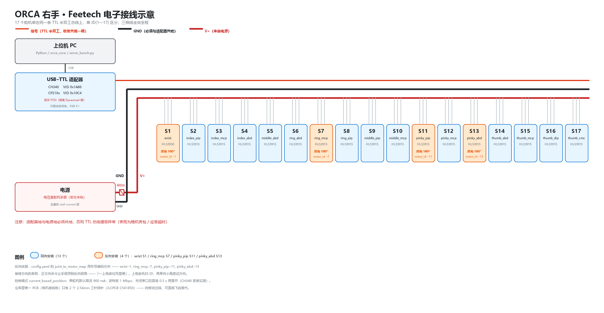

# ORCA 右手 电路/电子件准备清单（A1 · Feetech · v2 Base）

> 依据：`orcahand_hardware`（已稀疏克隆，只取了 `orca_v2/electronics`）、
> `orca_core/models/v2/orcahand-right/config.yaml`、`orca_core/hardware/*`、`constants.py`。
> 方案：**右手 · Feetech HLS 系列 · Bambu Lab A1**。
>
> 标 ✅ 的是**代码/仓库里核实过**的；标 ❓ 的是**仓库里查不到、必须从官方渠道确认**的。

---



> 上图：17 个舵机串在同一条 TTL 半双工总线上；适配器只驱动信号线，
> V+/GND 由电源供给（必须与适配器共地）；橙色 4 个是**反向安装**的关节。
> 图上每个框都标了 `S{电机ID}`、关节名、型号 —— 装机时可直接对照。

---

## 一、舵机：17 个，两种型号

`orcahand-right/config.yaml` 实测：

```
motor_ids   = [1..17]                    ← 连续，无跳号
joint_ids   = 17 个（1 wrist + 16 指关节）
joint_roms  = 每个关节的机械行程（度）
control_mode = current_based_position
max_current  = default
port         = auto
```

型号映射（来自 `docs/ORCA-3D打印建造方案.md` 对 orca_core 型号表的记录：
`4106 → HLS3930`、`6922/5130 → HLS3915`）：

| 部位 | 型号 | 数量 |
|---|---|---|
| 手腕 | **HLS3930** | **1** |
| 手指（拇指 4 + 四指各 3 = 16） | **HLS3915** | **16** |

- [ ] 采购 **1 × HLS3930 + 16 × HLS3915**
- [ ] ❓ **供电电压**：仓库与代码里都没有写死电压。`docs/ORCA-3D打印建造方案.md`
      明确记过「**电源电流规格官方未给**」。务必按你买到的那批 HLS3915/3930
      的**手册铭牌**确认电压，不要照 Dynamixel 的 12V 直接套。
- [ ] ❓ 峰值电流：按手册的 stall current 算总电源功率（见下面第四节）

---

## 二、仓库里唯一的一块 PCB：电机接线板（被动件）

`orcahand_hardware/orca_v2/electronics/` 只有这一块板（v1 的完全一样）：

- `ORCA_Motor_Connectors_BOM.xls` —— 已读出，**整块板只有 2 个元件**：

  | Comment | Designator | Footprint | JLCPCB 料号 |
  |---|---|---|---|
  | PM254V-11-03-H85 | H1, H2 | HDR-TH_3P-P2.54-V-F | **C541850** |

  即 **2 个 2.54mm 三针直插排针**，没有任何芯片。
- `ORCA_Motor_Connectors_Gerber/` —— 完整 Gerber + 钻孔文件
- `How-to-order-PCB.txt` —— 官方只给了个链接：<https://docs.easyeda.com/en/PCB/Order-PCB>

**它是纯被动的接线转接板**（舵机三线：电源/地/信号，TTL 半双工串联）。
所以它**不是必须品** —— 直接飞线也能跑；它的价值在于让腕部走线整洁、可拔插。

- [ ] 想省事就打这块板：把 Gerber 丢给嘉立创/EasyEDA 下单（5 片起步，很便宜）
- [ ] 或者直接跳过，自己焊接线

---

## 三、USB 侧：适配器与识别依据（代码里写死的）

`orca_core/constants.py` 的 `KNOWN_VIDS` 直接给出了**pc 端会认哪些芯片**：

```python
FEETECH:           0x1A86  # QinHeng CH340（多数 Feetech USB 适配器）
                   0x10C4  # Silicon Labs CP210x（部分 Feetech 板）
oh_board:          0x2F5D  # ORCA Dexterity 手控板（双 CDC，PID 0x2202）
tactile_sensor:    0x28E9  # Paxini 触觉传感器适配器
DYNAMIXEL:         0x0403  # FTDI（U2D2 最常见）
                   0x16D0  # MCS Electronics（部分 Robotis 板）
```

- [ ] 买 **CH340 或 CP210x 的 USB-TTL 适配器**（Feetech 总线用）。
      CH340 最常见也最便宜；CP210x 更稳。**别买 FTDI 的**（那是 Dynamixel 侧的识别码）。
- [ ] 触点：HLS 是 **TTL 半双工单总线**，适配器要能收发同一根信号线
      （市面「总线舵机 USB 调试板」多数就是这种）。

⚠️ **代码里记录的一个真实坑**（`constants.py:114`）：

```
MOTOR_PORT_CLOSE_SETTLE_S = 0.5
```
> 部分 USB-CDC 适配器（**实测出现在 CH340/CH343 家族**）在 close 之后立刻重开
> 会被拒绝；如果不留这 0.5s，一次健康检查触发的重连就可能把这个进程永久卡在
> "拒绝访问"上（因为再没人提示系统释放句柄）。
> —— 你自己写脚本时，**关闭串口后要等一下再开**，否则会出现"明明线没动却连不上"。

---

## 四、供电与电流（软件侧已给的约束）

`orca_core` 对 Feetech 的电流约定（实测自客户端类属性）：

| 量 | 值 | 含义 |
|---|---|---|
| `current_scale_ma` | 6.5 | 1 个寄存器单位 = 6.5 mA |
| `default_max_current_ma` | **900** | `config.yaml` 里 `max_current=default` → 每舵机默认限流 900 mA |
| `default_calibration_current_ma` | 900 | 标定时的电流 |
| `max_current_ma` | 13305.5 | 寄存器上限 2047 × 6.5 mA |

- [ ] 电源按 **17 × 舵机峰值** 留余量。注意**默认限流是 900 mA/舵机**，
      但那是软件限的，不是电源够不够的依据 —— 电源要按**电机 stall current** 配。
- [ ] ❓ 母线电压：见第一节的说明，**必须查手册**。
- [ ] 建议加**保险丝/急停**：17 个舵机同时堵转的电流很可观，而官方 BOM 页才给出确切值。
- [ ] 地线要共：USB 适配器地与电源地必须共地，否则 TTL 总线会通信异常。

---

## 五、方向与 ID：上电前必须对齐的两件事

`config.yaml` 的 `joint_to_motor_map` **用负号表示该关节的电机是反向安装的**：

```
wrist      : -1      ← 反向
ring_mcp   : -7      ← 反向
pinky_abd  : -13     ← 反向
pinky_pip  : -11     ← 反向
其余 13 个 : 正数（同向）
```

- [ ] **ID 必须 1–17 连续**，按上表的关节顺序分配，不能跳号（`absent_motor_ids()` 会报出来）
- [ ] 四个反向关节装机时**转 180° 装**或**信号线反接**（取决于电机固件是否支持反向），
      否则正方向命令会让手指往反方向顶 —— 这是最典型的"一上电就往死里攥"的成因
- [ ] 上电前先用 `python servo_bench.py --demo bus` 核对应答 ID 列表

---

## 六、仓库里**没有**的东西（必须外部获取）

| 缺什么 | 说明 |
|---|---|
| **OH Board 的设计文件** | `orca_core` 认识它（VID `0x2F5D`、双 CDC、921600 波特位握手 `ORCA_ID?`），但 `orcahand_hardware` 里**只有电机接线板**，没有 OH 板的 Gerber/BOM。要用它只能走官方渠道 |
| **电压/电流规格** | 仓库内无；官方 BOM 页 / Discord |
| **线束与端子清单** | 仓库内无（PTFE 管、腱绳、紧固件同样没有） |
| **触觉传感器** | 可选（v2 Base 不需要）；Paxini，VID `0x28E9` |

官方渠道（你文档里已记）：
- BOM 页：<https://www.orcahand.com/bill-of-materials>
- Discord：<https://discord.gg/xvGyxaccRa>（官网原话：BOM/装配资料在 Discord，"Not email"）

---

## 七、最小可跑清单（右手 + Feetech）

- [ ] 1 × HLS3930（腕）+ 16 × HLS3915（指）
- [ ] 1 × USB-TTL 适配器（**CH340** 或 CP210x）
- [ ] 1 × 电源（**电压查手册**，容量按 stall current 配）+ 保险丝
- [ ] 导线/端子若干（3 线：V/GND/信号，TTL 半双工）
- [ ] 共地：适配器地与电源地短接
- [ ] 打完电机接线板（可选，5 片起订）或直接飞线
- [ ] 上电顺序：**先不使能力矩** → 扫 ID → 改 ID/方向 → 试单向小角度 → 再全幅
