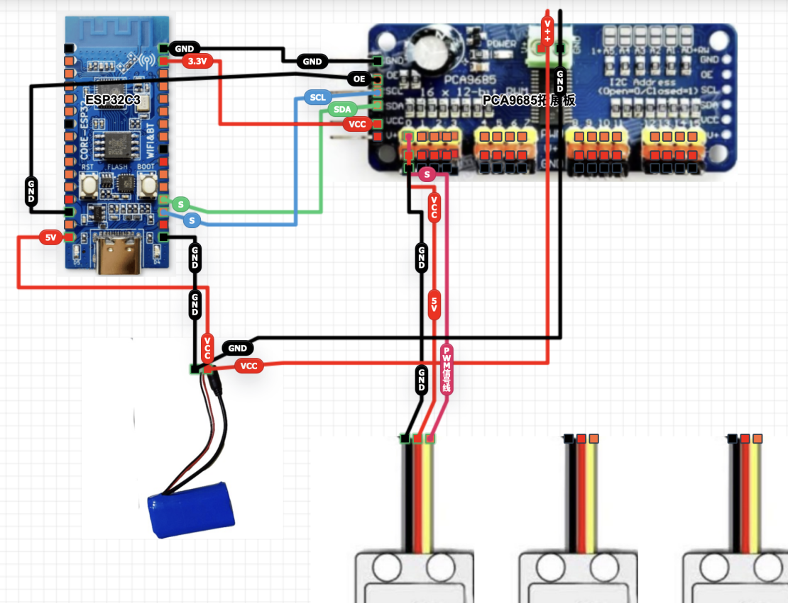

# 小楚君机械手 · 复现材料清单

> 依据：仓库内 `主控代码/sketch_26_7_4.ino`（I2C 引脚、通道分配、初始化）、
> `小楚君机械手接线文档.docx`（线序表 + 接线图，已抽出见下）、`3D/*.stl`（实测包围盒/体积/连通体数）。
> 价格是淘宝散件参考价，**未逐项核价**；「✅ 确定」= 仓库里有直接证据，「⚠️ 待确认」= 仓库里没有装配说明。
>
> 配套文档：[小楚君机械手-借鉴与接入.md](小楚君机械手-借鉴与接入.md)（代码/架构分析）
>
> **配图来源**：`小楚君机械手-接线图.png` 截自作者开源仓库的 `小楚君机械手接线文档.docx`（仅作技术分析引用）；
> `小楚君机械手-零件图.png` 由本文档作者用极简正交光栅化脚本对 `3D/*.stl` 渲染生成。
> 两者都只用于说明装配与选型，**不随 STL / 固件一并再分发**（见 `借鉴与接入` §7）。

## 0. 一句话

**材料费约 ¥85（自己打印）～ ¥160（代打印），电子件只有 4 样：ESP32-C3 + PCA9685 + 5×SG90 + 一个电解电容。**
真正要先搞清楚的不是「买什么」，而是「舵机怎么带动指节」——仓库里**没有装配说明**，这一项决定要不要买拉线/弹簧/销轴（见 §5）。

---

## 1. 电子件 ✅（接线图 + 固件双重确定）

| 件 | 具体规格 | 数量 | 参考价 | 选型注意 |
|---|---|---|---|---|
| **ESP32-C3 开发板** | **合宙 AirM2M CORE-ESP32C3**（丝印 `CORE-ESP32C3` / `WIFI&BT`、USB-C、RST/BOOT 双按键） | 1 | ¥12–18 | 代码里 `SDA=GPIO8 / SCL=GPIO9` 是这块板的引脚；**别买成 ESP32-S3 / C6 / WROOM-32**，引脚对不上 |
| **PCA9685 模块** | 16 路 12-bit I2C PWM，**带 V+ 螺钉端子**（图上那块蓝板） | 1 | ¥6–10 | 地址默认 `0x40`（A0–A5 全空）；买到不带端子排的也能用，但要自己焊电源线 |
| **舵机** | **SG90 9g**（180°），线色棕/红/黄（部分批是黑/红/黄） | **5** | ¥3.5–5/个 | 想耐用换 **MG90S 金属齿** ¥8–10/个；不要买 360° 连续旋转版（用不了） |
| **电解电容** | **470–1000 µF / 16 V**，预焊好引线 | 1 | ¥1–3 | 接线图里那根蓝皮圆柱——原文正文没提，但图上画了，**必须并到舵机 5V 与 GND 之间** |
| 杜邦线 | 母-母 20 cm | 10 根 | ¥3 | SDA/SCL/3V3/GND/OE 各 1 + 备用 |
| 舵机延长线 | 3P 公-母 10 cm | 5 根 | ¥3 | **取决于舵机线够不够长**，先量再买 |
| **电源** | USB-C 5V/**3A** 充电头 + 线 | 1 | ¥15–25 | 见 §4，这是最容易翻车的一环 |

> **上位机 exe 不用另外下载**：另一份文件夹 `小楚君机械手开源` 里就带着 `XiaochuHand.exe`（169 MB，
> PyInstaller 打包的 Python 3.10 + Kivy + bleak + MediaPipe）。复现时它**不是必需品** ——
> 协议是明文的（`servo_0..4=角度` + 11 个手势名），手机装个 BLE 调试 App 或我们的网页都能替代。
> 想省事也可以直接跑它：**滑块 / 自定义指令 / 手势可用**，但它的 Settings / About / OTA 三个功能
> 需要仓库固件里没有的 BLE 特征，点了会失败（细节见 [借鉴与接入](小楚君机械手-借鉴与接入.md) §4.2）。
> 好处是它自带手势识别（MediaPipe，模型和我们 `vendor/` 里那份完全相同），到手就能「举手开合」。

---

## 2. 3D 打印件 ✅（尺寸/体积为网格实测）

| 文件 | 包围盒 (mm) | 实体体积 | 是什么 | 耗材估算 |
|---|---|---|---|---|
| `Left_Hand.stl` / `Right_Hand.stl` | 56.5 × 98.9 × 96.8 | 171 cm³ | 手掌壳：背面弧形上缘一排 **5 个指根孔** | **二选一**，约 45–60 g |
| `all finger.stl` | 130.0 × 100.2 × 16.0 | 39 cm³ | **14 个独立指节**（5 指：拇指 2 节、其余各 3 节） | 约 12–16 g |
| `1.stl` | 120.0 × 130.0 × 40.0 | 44 cm³ | 底座盒（大概率装舵机/走线） | 约 12–16 g |
| `2.stl` | 127.8 × 137.0 × 8.0 | 9.3 cm³ | 底板 / 盖板 | 约 3–4 g |
| `Cover2.stl` | 113.1 × 150.2 × 109.9 | 134 cm³（**2 个连通体**） | 前臂外壳 + 盖 | 约 35–45 g |

- **打印体积要求：≥ 160 × 160 × 120 mm**。拓竹 A1 mini（180³）、Ender-3（220×220×250）都够；120³ 的小机器放不下 `Cover2`。
- **一只手的实际耗材约 110–140 g PLA**（0.2 mm 层高 / 3 圈墙 / 20% 填充），买 250 g 或 1 kg 一卷都行。
- 建议参数：层高 0.2 mm；指节和铰链孔位用 **0.16 mm + 降速**（孔会收缩）；手掌壳有悬空，用**树状支撑**（接触 Z 距离 0.2）。
- 打印顺序：**先打 `all finger.stl` + `Left_Hand.stl` 试装**，别一次打全套（见 §5）。

---

## 3. 机械辅件（部分待确认）

| 件 | 规格 | 数量 | 状态 |
|---|---|---|---|
| 紧固件 | M3×8/12 内六角 + 螺母 | 各 10 | ✅ 外壳/底座合盖用得上 |
| 自攻螺丝 | M2×6 圆头 | 10 | ✅ SG90 一般每只自带 2 颗，先用自带的 |
| 关节销 | Φ3 钢销 / 尼龙棒 | 视装法 | ⚠️ **可能不需要**：网格显示指节自带**公销 + 母孔**，14 件互为卡扣 |
| 拉线 | 鱼线 / 凯夫拉 0.6–1.0 mm | 2 m | ⚠️ 只有「绳驱」方案才要 |
| 回位弹簧 | 拉簧 0.2 × 4 × 15 | 5 | ⚠️ 同上 |
| 走线辅料 | 尼龙扎带、热熔胶、双面胶 | — | ✅ 固定舵机/理线 |

---

## 4. 接线与电源（照图接，别自己改）⚠️

| ESP32-C3 | → | PCA9685 |
|---|---|---|
| `3V3` | → | `VCC`（只给芯片，电流很小） |
| `GND` | → | `GND`（**必须共地**） |
| `GPIO8` | → | `SDA` |
| `GPIO9` | → | `SCL` |
| `GND` | → | `OE`（接地 = 输出常开） |
| `5V` | → | `V+`（螺钉端子）+ 电容并到 GND |

舵机 3P 直接插 PCA9685 的通道 **0–4**：拇/食/中/无名/小。
线色：**棕或黑 = GND、红 = 5V、黄或橙 = PWM**。接反会瞬间烧舵机。

### 四个坑（接线图上都看不出来）

1. **5V 是从 C3 的 `5V` 引脚取的**：整只手（5 个舵机 + 电容 + 板子）的电流都要过 USB-C 口和板上那条细走线。
   SG90 堵转约 700 mA/个，5 个同时动 **> 3 A**。USB 5V/2A 以下必翻车（ESP32 复位、舵机乱抖）。
   → 稳妥做法：**外接 5V/3A 直接喂 PCA9685 的 V+**，C3 单独用 USB 供电，**两路 5V 必须共地**。
2. **`OE` 接地 = 舵机常开**：静止时也在持续保持力矩，SG90 会一直嗡嗡响、发热。后面建议把 OE 改到一根 GPIO 上做「静止断电」。
3. **`GPIO9` 是 ESP32-C3 的 BOOT 拉脚**：上电时被拉低会进下载模式。I2C 上拉能保住高电平，但别再在这根线上挂别的拉低负载。
4. 电容别省：5 个舵机同时启动的瞬态会把 5V 拉塌，那 470–1000 µF 就是干这个的。

---

## 5. 三个必须先确认的点 ⚠️（决定 §3 买什么）

仓库里只有**接线文档**，**没有装配文档**。以下三件事无法从代码和 STL 确定：

1. **舵机怎么带动指节？** 直驱 / 连杆 / 绳驱？
   → 决定要不要买**拉线 + 回位弹簧 + 连杆料**。从模型看：舵机只可能装在 `1.stl` 底座盒里，
   而指节在手掌上，两者隔着一段距离 —— 所以**绳驱的可能性最大**，但没证据。
2. **手掌上那 5 个指根孔怎么固定指节？** 自攻螺丝 / 销轴 / 打印卡扣？
   → 决定 M2/M3 螺丝买多少。我渲染网格看指节是「一端凸销、一端圆孔」的**卡扣结构**，大概率免五金。
3. **5 个舵机装在哪、怎么固定？** `1.stl` 盒内？要不要舵机支架？
   → 决定是否额外买舵机支架/热熔胶板。

**怎么拿到答案**（按代价从低到高）：
1. 看教程视频：作者 ID **小楚君cc**（B 站/抖音），装配过程在视频里；
2. 只打 `all finger.stl`（12–16 g，1 小时）+ `Left_Hand.stl`，**实物试装**，看销孔怎么配；
3. 直接把 STL 拖进切片软件，逐层翻一下 `1.stl` 内部——能看出有没有 **5 个 SG90 大小（23×12×22.5 mm）的凹槽**。

---

## 6. 工具（没有的话 ≈ ¥100 一次性投入）

电烙铁 + 焊锡（或杜邦线压线钳）、斜口钳、十字/内六角螺丝刀、热熔胶枪、万用表（验通断和 5V）、
游标卡尺（量销孔直径用）。

---

## 7. 预算汇总

| 方案 | 电子 | 打印 | 合计 |
|---|---|---|---|
| 自己有打印机（SG90） | ≈ ¥70 | ≈ ¥12（140 g PLA） | **≈ ¥85** |
| 自己有打印机（MG90S 金属齿） | ≈ ¥95 | ≈ ¥12 | ≈ ¥107 |
| 淘宝代打印 + SG90 | ≈ ¥70 | ¥60–90（按克计价） | ¥130–160 |

> 这套电子件和 `index.html` 里的 BOM（SG90 ¥25 + PCA9685 ¥8 + ESP32 ¥15）**是同一套东西**，
> 如果 `docs/ORCA-自主架构-PWM方案.md` §7「下一步 1」已经买过 1 个舵机 + 1 个 PCA9685，只需补剩下的。

---

## 8. 建议的采购/复现顺序

1. **先下单电子四件套**（ESP32-C3 + PCA9685 + 5×SG90 + 电容）+ 5V/3A 电源。
   到手先照接线图接好、烧 `sketch_26_7_4.ino`，用手机 BLE 调试 App 发 `servo_0=90` 验证五指都能动
   （或直接跑 `小楚君机械手开源/XiaochuHand.exe`，127.0.0.1 之外的蓝牙连上就能用滑块 + 手势）。
   ✅ 这一步直接完成了 `docs/ORCA-自主架构-PWM方案.md` §7 的「买 1 个舵机 + 1 个 PCA9685 实测死区/重复精度/分辨率」。
2. **同时只打 `all finger.stl` + `Left_Hand.stl`**（≈ 60 g，2–3 小时），先解决 §5 的三个疑问。
3. 装配方式确认后，再打 `Cover2.stl` + `1.stl` + `2.stl`。
4. 上位机阶段：先用手机 BLE 调，稳定后接我们网页的 Web Bluetooth 后端（见 [借鉴与接入](小楚君机械手-借鉴与接入.md) §4）。

> ⚠️ 授权提醒：该仓库**没有 LICENSE**。只做自用复现没问题；要做 `淘宝3D打印交付包.md` 那种对外交付，
> STL 和固件**不能直接复印分发**（详见 [借鉴与接入](小楚君机械手-借鉴与接入.md) §7）。
