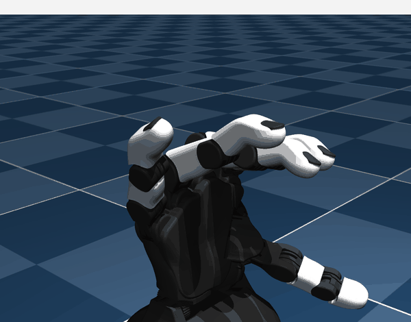
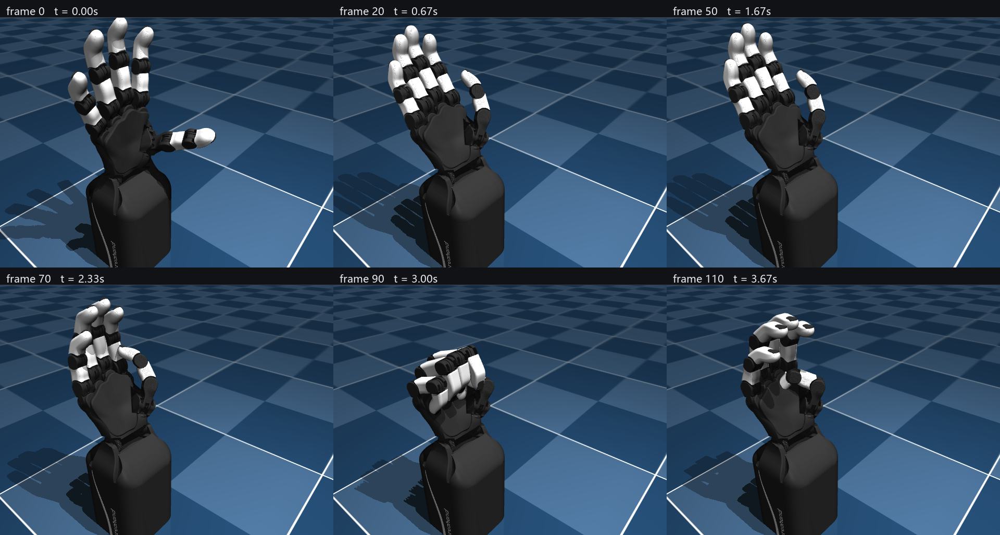
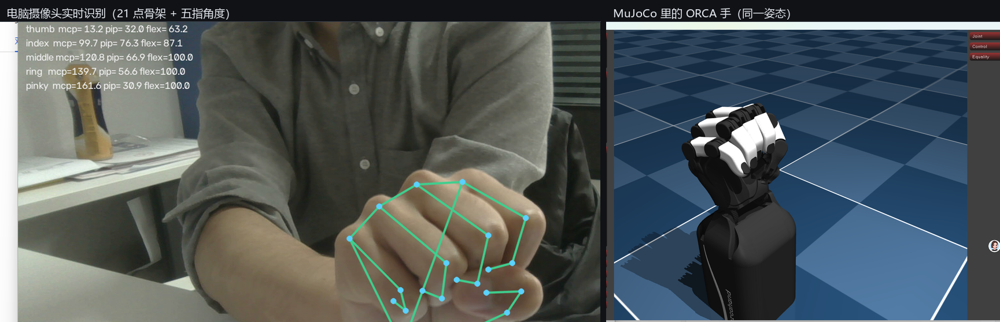
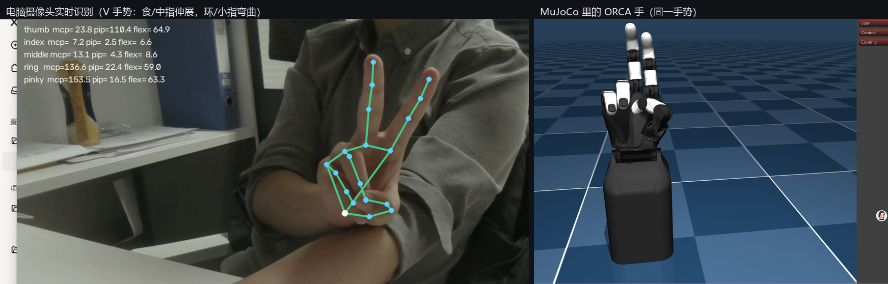

# orca-link

把本项目 [finger-motion-replay](../README.md) 的视觉采集接到 [ORCA Hand](https://github.com/orcahand/orca_core) 上。

你的视觉主端每帧算出 21 个手部关键点与五指屈曲角，本来只推给 Minecraft 的 CC:Tweaked。
这一层把同一份数据接到真机灵巧手（或它的仿真/内存 mock）上。

```
capture.html ──POST /update──▶ orca-link ──┬─ 关节角仿射映射 ──▶ orca_core（含 MockOrcaHand）
                 （你现有的 payload）        └─ HandFrame/gRPC ──▶ orca_teleop 的重定向器
```

---

## 快速开始

```powershell
# 1) 环境（Python 3.12：orca_teleop 限定 <3.13，且 grpcio 1.62 / protobuf 4.25 要对齐）
uv venv --python 3.12 .venv
uv pip install --python .venv\Scripts\python.exe -e <ORCA_LINK_ORCA_ROOT>\orca_core-upstream `
    grpcio==1.62.3 grpcio-tools==1.62.3 protobuf==4.25.9 setuptools

# 2) 生成 gRPC 桩（从 orca_teleop 的 proto 原件，保证线上格式一致）
.\.venv\Scripts\python.exe gen_proto.py

# 3) 自检：映射 + gRPC 回环 + MockOrcaHand 端到端，应 28 项全绿
.\.venv\Scripts\python.exe verify.py

# 4) 起桥接（默认 print sink，只打印不驱动硬件）
.\.venv\Scripts\python.exe orca_bridge.py --sink print
```

另开一个终端，把一帧推给它：

```powershell
$body = '{"hand":true,"source":"webcam-mediapipe","fingers":{"index":{"flex":37.8,"mcp":14.2,"pip":22.6,"dip":19.3}}}'
Invoke-RestMethod -Uri http://127.0.0.1:8766/update -Method Post -Body $body -ContentType application/json
Invoke-RestMethod -Uri http://127.0.0.1:8766/orca_joints
```

---

## 机器人侧的四种 drive

`teleop_live.py` 起的是官方 `pipeline.run()`，`--drive` 决定关节目标最终去哪：

| drive | 作用 | 需要 |
|------|------|------|
| `print` | 只打印关节角 | 无 |
| `mock` | `MockOrcaHand`，内存里跑 | `orca_core` |
| `sim` | **`orca_sim` 的 MuJoCo 仿真**，有物理、会渲染画面 | `mujoco` + `gymnasium` + `orca_sim` |
| `real` | 真机（会连接、会标定、会动） | 硬件 |

```powershell
<conda env>\python.exe teleop_live.py --drive sim                  # 仿真，帧写到 sim_frames/
<conda env>\python.exe teleop_live.py --drive sim --sim-every 6    # 每 6 步存一帧
<conda env>\python.exe teleop_live.py --drive real                 # 真机
```

### 仿真实测（无硬件）

同一套链路驱动 `orca_sim` 的 v2 手，30Hz 推入"张开 → 握拳 → 张开"：


动作往返成立。注意中间那帧主要是**掌指关节在弯、远端指节偏直**——这是合成 landmark
不严谨导致的（PIP 的命令值本身只有 -10.0 → -8.7），不是重定向器的问题。

### 看实时动画（MuJoCo 交互窗口）

静态图看不够就直接开窗口，手掌会实时跟着输入动；窗口本身可鼠标旋转/缩放：

```powershell
# 终端 1：实时窗口（会弹出 "MuJoCo : ORCA hand right scene"）
<conda env>\python.exe teleop_live.py --drive sim --sim-render human --sim-out=

# 终端 2：桥接
<conda env>\python.exe orca_bridge.py --sink grpc

# 终端 3：连续手势驱动（--seconds 0 = 一直跑）
<conda env>\python.exe drive_gestures.py --pattern wave --seconds 0
```

`drive_gestures.py` 与 `drive_synthetic.py` 的区别：后者只在"张开/握拳"两个离散姿态间跳，
适合做静态对比；前者按正弦连续改变屈曲量，实时窗口里才是平滑的动画。两种模式：
`--pattern pulse`（五指同步开合）与 `--pattern wave`（五指依次屈伸）。



上面这段 GIF 是从**正在运行的窗口**直接录的（`PrintWindow` 抓取 + 调色板量化，
44 帧 / 1.94 MB），所以画面里能看到 MuJoCo 自己的控制面板——它是真实窗口，不是重新渲染。
六格定帧见 [docs/orca-sim-live-strip.png](docs/orca-sim-live-strip.png)。

录制期间实测：窗口内容每 0.7~0.9 秒有 **7~13% 的像素明显变化**，相邻帧平均差 6.5~10.2，
确认是连续运动而非冻结画面。

**坑 5：官方 sim sink 拼错了模型目录名。**
`OrcaHandSimSink._resolve_retarget_model_path` 找的是
`models/<version>/orcahand_<env>/config.yaml`（**下划线**），而 orca_core 里实际是
`orcahand-right`（**连字符**），于是返回 `None` 并在 `connect()` 抛 `RuntimeError`。
`teleop_live.py` 用子类覆盖该方法绕开，同时借它把渲染帧落盘（上游只在
`render_mode="human"` 时出画面，无显示器的一侧看不到）。

---

## sink 三种模式（`orca_bridge.py`，与上面的 drive 是两回事）

| sink | 作用 | 依赖 |
|------|------|------|
| `print` | 只打印映射结果，用来对表排错 | 无 |
| `orca` | 驱动 `orca_core`。默认 `mock: true` = **不碰硬件的 MockOrcaHand** | `orca_core` |
| `grpc` | 作为 publisher 把世界坐标推给 `orca_teleop` 的 `IngressServer`，由官方重定向器求解关节 | `grpcio` + `proto_gen` |

```powershell
.\.venv\Scripts\python.exe orca_bridge.py --sink orca              # MockOrcaHand，内存里跑
.\.venv\Scripts\python.exe orca_bridge.py --sink orca --real       # 连真机（会标定、会动）
.\.venv\Scripts\python.exe orca_bridge.py --sink grpc              # 推给 50051 上的 ingress
```

`sink=grpc` 需要 payload 带 `world_landmarks`；`finger-motion-replay/app.js` 已经会带（见下）。

---

## 端点

| 方法 | 路径 | 说明 |
|------|------|------|
| POST | `/update` | 收你视觉主端的原样 payload；多了 `world_landmarks` 也可以 |
| GET | `/orca_joints` | 当前 17 个关节目标 + 按 `joint_ids` 排好的数组 + sink 状态 |
| GET | `/health` | 存活探测 |
| GET | `/reset` | 回到"没有数据"状态 |

端口默认 **8766**，因为 8765 被你的 MC 中继（`bridge_server.py`）占着。两者可以同时跑。

---

## Path A：走官方重定向器（已在 Windows 上打通）

```
capture.html ──POST /update──▶ orca_bridge.py --sink grpc ──HandFrame/gRPC──▶
    orca_teleop IngressServer ──▶ AdaptiveAnalyticalRetargeter ──▶ 17 个 ORCA 关节角
```

`test_full_chain.py` 把这条链路的**两侧真实代码**串起来跑，10 项全绿。

### 为什么不能照官方 README 装

官方说 `uv sync --extra adaptive`。**这在 Windows 上必然失败**：`adaptive` 额外依赖
`pin`(Pinocchio) / `cmeel-urdfdom` / `cmeel-tinyxml2`，而这三个包**在 PyPI 上从来没有
Windows 轮子**（我查了全部历史版本，win_amd64 数量为 0）。`nlopt`、`torch`、
`pytorch-kinematics` 倒是有。

### 可用配方（`setup-teleop-env.ps1` 已实现）

1. **Pinocchio + NLopt 从 conda-forge 取**，不要走 pip。conda-forge 有
   `win-64/pinocchio-4.1.0-py312h2d15979_1.conda`，与 pip 的 `pin 4.1.0` 同版本号。
2. 其余依赖照常 pip：`torch`（用 CPU 索引，Windows 上 PyPI 默认给 CUDA 版）、
   `pytorch-kinematics`、`grpcio`、`protobuf<5`。
3. **`orca_teleop` 本体用 `pip install --no-deps`**，否则 pip 会回头去拉 cmeel 的 `pin`。
4. 设 `ORCAHAND_DESCRIPTION_DIR` 指向 orcahand_description 检出目录。

### 三个必须知道的坑

**坑 1：模型版本要用「v2 手配置 + v1 URDF」。**
`orcahand_description` 里 **v2 的 URDF/MJCF 是 CAD 命名**（`I-AP-R_d95d02d1`、
`right_i-mcp_actuator`），而重定向配置的 v2 帧表要的是 `right_index_mcp` 这类语义名——
实测 16 个关节全部找不到。**v1 的 URDF 才是语义命名**，v2 帧表要的 21 个帧名在 v1 URDF 里
全部存在。所以：

```python
AdaptiveAnalyticalRetargeter(
    hand_config_path=".../models/v2/orcahand-right/config.yaml",   # v2 配置
    urdf_path=".../orcahand_description/v1/models/urdf/orcahand_right.urdf",  # v1 URDF
    config_path="configs/adaptive_analytical_orca_windows.yaml",
)
```

注意 `urdf_path=None` 时它按 `model_version` 去拼 `<base>/v2/models/urdf/...`，所以 v2 配置
**必须显式传 `urdf_path`**。

**坑 2：上游的 `joint_name_aliases` 方向是反的。**
它写的是 `{thumb_pip: thumb_cmc}`，但 alias 的语义是「配置关节名 → URDF 关节名后缀」。
v1 配置本身就叫 `thumb_pip`，套上这条反而去找 `right_thumb_cmc`；v2 配置叫 `thumb_cmc`，
键对不上、alias 不生效，也去找 `right_thumb_cmc`——**两种组合都差这一个关节**。
[configs/adaptive_analytical_orca_windows.yaml](configs/adaptive_analytical_orca_windows.yaml)
把它改成 `{thumb_cmc: thumb_pip}` 即可打通。

**坑 3：conda 的 OpenMP 会和 torch 撞。**
报 `OMP: Error #15: Initializing libomp.dll, but found libiomp5md.dll already initialized`
并直接终止。这是 conda(pinocchio/nlopt) + pip(torch) 混装的代价。设
`KMP_DUPLICATE_LIB_OK=TRUE` 可绕过（必须在 import torch/nlopt/pinocchio **之前**设）。
想彻底避免就得让 nlopt 走 pip、并避免 pinocchio 拉 mkl。

### 坑 4：重定向配置必须是纯 ASCII（上游默认配置在中文 Windows 上直接报错）

`adaptive_analytical.py` 用 `open(path)` 读配置，**没指定 `encoding`**。中文 Windows 的
首选编码是 **cp936(GBK)**，于是：

- **上游自带的 `adaptive_analytical_orca.yaml` 本身就加载不了**——它含一个 em-dash，实测
  `'gbk' codec can't decode byte 0x94 in position 2037`。
- GBK 解 UTF-8 字节是**按位置对齐**的，所以这个错误时隐时现：同一个文件多写几行注释，
  字节偏移一变，就从"能读"变成"报错"。

[configs/adaptive_analytical_orca_windows.yaml](configs/adaptive_analytical_orca_windows.yaml)
是 **0 个非 ASCII 字节**的。改它时请保持，否则装配会在 `yaml.safe_load` 上炸掉。

### 怎么用你的摄像头跑起来（三个终端）

```powershell
# 终端 1：机器人侧常驻（官方 pipeline）。先 print/mock 确认无误再换 real
D:\tools\miniconda\envs\orca-teleop\python.exe teleop_live.py --drive mock

# 终端 2：桥接，把帧经 gRPC 推给机器人侧（默认 localhost:50051）
D:\tools\miniconda\envs\orca-teleop\python.exe orca_bridge.py --sink grpc

# 终端 3：你的视觉主端
cd ..   # 回到项目根
python -m http.server 8000     # 浏览器开 http://localhost:8000/capture.html
```

**捕获页要发到 8766，不是 8765。** 把 `app.js` 的 `BRIDGE_URL` 改成
`http://127.0.0.1:8766/update`（一行）。`bridge_config.yaml` 里默认的
`forward_to: http://127.0.0.1:8765/update` 会把原始 payload 再转发给你的 MC 中继，
于是**同一只手同时驱动 MC 机械手和 ORCA 灵巧手**。

转发是异步的（独立线程 + 有界队列，满则丢最旧），对方没起也不影响主链路；
`GET /orca_joints` 里有 `forwarded` / `forward_failed` / `forward_error` 计数。

没有摄像头时也能验证整条链路：

```powershell
# 终端 1 起 teleop_live.py --drive mock，终端 2 起 orca_bridge.py --sink grpc，然后
python drive_synthetic.py --seconds 9 --hz 30
```

实测（30Hz、270 帧全部送达、204 次关节目标，张开 → 握拳 → 张开）：

```
[live] #1     in·mcp=  9.2   mi·mcp= 12.1  ...
[live] #65    in·mcp= 83.1   mi·mcp= 89.1  ...   <- 握拳
[live] #173   in·mcp=  9.1   mi·mcp= 12.1  ...   <- 张开
```

### 从手机小程序接入（局域网，已实测）

`miniprogram/` 那套视觉主端（微信 VisionKit，iPhone 真机实测 30fps / 21 点）可以直接
drive 这一层，**不需要改 bridge 的任何代码** —— payload 结构与网页端 `app.js` 一致。

```powershell
# 终端 1：MC 中继（可选，用来验证「一只手同时驱动两边」）
python bridge_server.py --host 0.0.0.0

# 终端 2：ORCA 桥接 —— 必须 --host 0.0.0.0，否则手机连不上（默认只监听回环）
python orca_bridge.py --sink print --host 0.0.0.0
```

小程序里开启「上行到 ORCA / 机械手」，地址填 **`<电脑局域网IP>:8766`**。
不要填 8765 —— 8765 只驱动 MC；8766 会映射到 17 个 ORCA 关节**并**把原始 payload
转发给 8765，所以填 8766 时两边一起动。

`--host` 就是为手机接入加的（`--port` 的同款用法）。

**实测（本机回环，payload 与小程序的完全同构）**：

```
POST /update {"hand":true,"source":"miniprogram-visionkit","fingers":{...}} → {"ok":true,"frames":1}
GET  /orca_joints（7ms 后）  hand=true   index_mcp=80.4  index_pip=76.7  thumb_mcp=79.9   ← 输入 80/70/60
GET  /orca_joints（800ms 后）hand=false  index_mcp= 2.0                              ← miss_grace_ms=250 回中立
GET  http://127.0.0.1:8765/angles → 原样拿到五指数据（forwarded=1, forward_failed=0）
```

注意后两行：**超过 `miss_grace_ms`（默认 250ms）没有新帧就回中立位**。
小程序是 10Hz（100ms）推送，正好压在这个宽限期以内；若把推送降到 5Hz 以下，
ORCA 侧会在中立位与目标之间来回跳 —— 排查时别误判成"映射坏了"。

**当前用的是近似 ROM**：本机没有 orca_core 检出，启动日志会提示
`未找到 orca_core 检出（FileNotFoundError），改用内置 ROM 副本`。
映射照常可用，但 ROM 是内置副本；装上 orca_core 后 `mapping_source` 会变成真实 config.yaml。

### 仿真环境：已装好并通过 sim_drive 跑通

> 本节最初写的是「一个都没有」——那是搭建**之前**的盘点，现已全部就位，保留此更正以免误读。

| 依赖 | 状态 |
|---|---|
| `orca_core` / `orca_teleop` / `orcahand_description` / `orca_sim` 检出 | ✅ 在 `orca-ecosystem/`（已 gitignore，约 815 MB，用上方 4 条 clone 命令重建） |
| `mujoco` / `gymnasium` | ✅ 3.15.0 / 1.4.0 |
| conda 环境 `orca-teleop`（python 3.12 + conda-forge 的 Pinocchio 4.1.0 + NLopt） | ✅ 在 `C:\Users\<你>\.conda\envs\orca-teleop` |

仍然**没有**安装的是 `orca_teleop` 这个包本身（`--drive sim` 那条官方路要走它的
`OrcaHandSimSink` + 重定向器）。但对本项目的目标而言不需要它 —— 见下一节的
`sim_drive.py`：它直接驱动 `orca_sim` 的 env，**绕开重定向器**，因此也绕开了
`orca_teleop` 会拖进的 torch / grpcio，以及重定向器必需的 `world_landmarks`。

若日后确实要走官方 `teleop_live.py --drive sim`，再按「快速开始」与「Path A」
补齐 `orca_teleop`（注意那两节记录的四个 Windows 坑：`pin`/`cmeel-*` 在 PyPI
无 Windows 轮子、`joint_name_aliases` 方向是反的、OpenMP 撞车、重定向配置必须纯 ASCII）。

### 用关节角直接驱动仿真（`sim_drive.py`，不需要重定向器）

`--drive sim` 那条官方路径的输入是 `AdaptiveAnalyticalRetargeter`，而重定向器要
**米制、腕部相对的 `world_landmarks`** —— 微信小程序走 VisionKit **2D**，只有 0–1
归一化图像坐标，拿不到（VisionKit 3D 要微信 ≥ 8.1.0）。所以手机数据喂不进那条路。

但 `orca_sim` 的 env **直接吃关节位置**，而 `orca_hand_map.from_vision_payload()`
已经把 payload 映射成了 17 个关节目标。`sim_drive.py` 就是把这两端接起来：

```
小程序 / drive_gestures / 网页端 ──POST /update──▶ orca_bridge.py (8766)
                                                      │
                        sim_drive.py 轮询 GET /orca_joints ──▶ orca_sim 的 MuJoCo env
```

好处：**torch / pinocchio / nlopt / grpcio 全都不需要**，只要 `mujoco` + `gymnasium`
+ `orca_sim` + `orca_core`。数据入口仍是 orca_bridge，不新开端口，所以同一只手可以
同时驱动 MC 机械手（转发）、ORCA 映射（`/orca_joints`）和仿真。

```powershell
# 终端1：入口
python orca_bridge.py --sink print --host 0.0.0.0
# 终端2：仿真（弹出 MuJoCo 交互窗口）
python sim_drive.py --render human
# 终端3：没接手机时用合成手势驱动（--seconds 0 = 一直跑）
python drive_gestures.py --pattern pulse --seconds 0 --hz 30
```

实测（合成 pulse，30Hz，120 帧）：17 个执行器与 config `joint_ids` 一一映射，
**120/120 帧取到桥接数据**，关节在 ~12° 与 ~106° 之间往复：



⚠️ 两个坑（都踩过）：

1. **`orca_core` 的手配置目录名是连字符**：`models/v2/orcahand-right/config.yaml`，
   而上游 sim sink 拼的是下划线 `orcahand_right` → 返回 `None` 并在 `connect()` 抛
   `RuntimeError`（即上文「坑 5」）。`sim_drive.py` 直接拼对。
2. `orca_sim` 的 `render_mode` 只接受 `None` / `"human"` / `"rgb_array"`，
   传字符串 `"none"` 会 `ValueError: Unsupported render_mode`。

环境安装（本机实际用的路径，与上文 `D:\tools\miniconda` 不同）：

```powershell
# conda 环境落在用户目录（ProgramData 需提权，conda 会自动回退）
C:\ProgramData\miniconda3\Scripts\conda.exe create -n orca-teleop `
    --override-channels -c https://mirrors.tuna.tsinghua.edu.cn/anaconda/cloud/conda-forge `
    python=3.12 pinocchio=4.1.0 nlopt pyyaml -y
$py = "C:\Users\<你>\.conda\envs\orca-teleop\python.exe"
& $py -m pip install mujoco gymnasium pillow
& $py -m pip install --no-deps -e <orca-ecosystem>\orca_core-upstream
& $py -m pip install -e <orca-ecosystem>\orca_sim
# orca_core 的导入链会走到 hardware/hand_serial_link.py -> import serial，所以
& $py -m pip install pyserial dynamixel-sdk fastapi uvicorn
```

四个上游检出（都在 `orca-ecosystem/`，已 gitignore）：

```
git clone --depth 1 https://github.com/orcahand/orca_core.git            orca_core-upstream
git clone --depth 1 https://github.com/orcahand/orca_teleop.git          orca_teleop
git clone --depth 1 https://github.com/orcahand/orcahand_description.git orcahand_description
git clone --depth 1 https://github.com/orcahand/orca_sim.git             orca_sim
```

> `orca_teleop` 只在走重定向器（Path A / grpc）时才需要；`sim_drive.py` 那条路不用它。

### 用电脑本地摄像头直接驱动（`webcam_drive.py`）

不想掏手机时，用这台电脑的摄像头就是最省事的视觉源：

```
摄像头 ──MediaPipe HandLandmarker（本地 vendor/hand_landmarker.task）──▶ 关节角
        ──POST /update──▶ orca_bridge(8766) ──▶ sim_drive ──▶ MuJoCo
```

角度口径与网页端 `app.js`、小程序 `core/hand.js` **完全一致**（同一个
`angleBetween` / `toFlexion` 与三关节结构），所以三者可以互换喂同一条链路。
模型直接用仓库里已有的 `vendor/hand_landmarker.task`，**不需要联网下载**。

一处**有意的改进**：网页端/小程序都在 0–1 归一化空间里算角度，而 x/y 缩放不同
（画面非正方形时）会带来系统性偏差；这里知道真实分辨率，所以**乘回像素再算**，
几何上才是真角度。

```powershell
# 实时摄像头（--show 开预览窗，画 21 点骨架与五指角度）
python webcam_drive.py --show
# 只识别不发送，先确认能认出你的手
python webcam_drive.py --show --no-send
# 单张图片跑一遍（离线验证整条链路，不需要有人举手）
python webcam_drive.py --image hand.jpg --seconds 3
```

实测：真手掌照片 **315/315 帧全部检出**；实时摄像头下
**4561 帧检出 2612 帧（约 57%，手在画面里进出）**、上行 1888 次 0 失败，
桥接 `hand=True`、仿真关节值随手指动作实时变化。

**真机验证**：下面这张是同一时刻截下的两个窗口 —— 左边摄像头预览（21 点骨架 +
五指角度），右边 MuJoCo 里的 ORCA 手，**姿态一致**：



那一刻的读数是一只**握紧的拳头**，仿真手也随之握紧：

```
thumb   mcp= 13.2  pip= 32.0  flex= 63.2
index   mcp= 99.7  pip= 76.3  flex= 87.1
middle  mcp=120.8  pip= 66.9  flex=100.0
ring    mcp=139.7  pip= 56.6  flex=100.0
pinky   mcp=161.6  pip= 30.9  flex=100.0
```

**更能说明问题的是不对称手势**：V（胜利）手势下食指/中指伸展、环指/小指弯曲，
两组读数差了近一个数量级 —— 这证明是**逐指独立驱动**，而不是只有"张开/握拳"两态：



```
thumb   mcp= 23.8  pip=110.4  flex= 64.9
index   mcp=  7.2  pip=  2.5  flex=  6.6   <- 伸展
middle  mcp= 13.1  pip=  4.3  flex=  8.6   <- 伸展
ring    mcp=136.6  pip= 22.4  flex= 59.0   <- 弯曲
pinky   mcp=153.5  pip= 16.5  flex= 63.3   <- 弯曲
```

> 两张入库图都是从整屏截图裁出的「预览窗 + MuJoCo 3D 画面」两格对照：原始截图里
> 还有软著材料 PDF 阅读器与编辑器面板，而本仓库是公开的。MuJoCo 格的边界不是眼估的
> —— 按钮面板近黑、3D 地面是蓝色，扫多行取「蓝色连续出现」的起点得 x≈1276，底边 y≈1308。

⚠️ 一个启动时的坑：**mediapipe 导入 + 模型加载要 8–10 秒**才会发第一帧。
这段时间里桥接显示 `hand=False` 属正常，不是链路坏了（我一开始就误判过）。

### 一键起全套（`run_stack.ps1`）

本仓库路径含空格（`Personal Portfolio Area`），而 `Start-Process` **不会**帮你加引号 ——
脚本路径不加引号会静默失败：

```
python.exe: can't open file 'D:\Personal': [Errno 2] No such file or directory
```

这个坑我在同一次会话里踩了三次，所以把启动逻辑固化成一个脚本：

```powershell
cd orca-link
powershell -NoProfile -ExecutionPolicy Bypass -File run_stack.ps1                 # 桥接 + 仿真 + 摄像头
powershell -NoProfile -ExecutionPolicy Bypass -File run_stack.ps1 -Driver gestures # 用合成手势代替摄像头
powershell -NoProfile -ExecutionPolicy Bypass -File run_stack.ps1 -Driver none -NoSim   # 只起桥接
powershell -NoProfile -ExecutionPolicy Bypass -File run_stack.ps1 -Restart         # 先清掉上一轮实例
```

各进程日志写在 `orca-link/logs/`（已 gitignore）。

### 其它行为特征

- **前 30 帧重定向器返回 `None`**，是自动尺度标定期，机械手保持 `init_joints()` 姿态不动。
- 返回的 `OrcaJointPositions` 内部顺序是**四指在前、`wrist` 在最后**，与
  `config.joint_ids`（`wrist` 在最前）**不一致**。用 dict 无所谓；要拼 ndarray 请务必走
  `action.as_array(hand.config.joint_ids)`。
- `orca_teleop` 的 gRPC 桩优先于本目录 `proto_gen/`：两者同时注册会报
  `duplicate symbol 'orca_teleop.HandFrame'`，代码里已做优先级处理。

### 质量说明（重要）

`test_retargeter.py` / `test_full_chain.py` 用的是**我手工合成的 landmark**，解剖学上不严谨。
实测结果是四指 MCP 对「握拳」有 +68~77° 的强响应、外展 +15~17°，但 **PIP 几乎不动、
拇指顶在 ROM 下界**。这更像是合成姿势的问题，**不能据此判断重定向质量**。
要评估质量必须喂真实摄像头数据（你浏览器里的 `worldLandmarks`，或 ORCA 自带的
`ingress/mediapipe/publisher.py`）。


---

## 映射怎么定的

真值来自 ORCA 的 `config.yaml`（`joint_ids` / `joint_roms` / `neutral_position`），不是硬编码；
读不到时才用内置的 v2 右手副本兜底。

```
目标 = neutral + gain × (视觉屈曲角 / 满屈曲角) × (rom_max − neutral)      再夹到 [rom_min, rom_max]
```

| 视觉输入 | ORCA 关节 |
|---|---|
| `thumb.mcp` (CMC) | `thumb_cmc` |
| `thumb.pip` (MCP) | `thumb_mcp` |
| `thumb.dip` (IP) | `thumb_dip` |
| `{index,middle,ring,pinky}.mcp` | `*_mcp` |
| `{index,middle,ring,pinky}.pip` | `*_pip` |
| 四指的 `.dip` | **丢弃**（ORCA v2 四指没有 DIP 关节） |
| 五指外展、腕 | 视觉算不出 → 保持中立位 |

**拇指键名陷阱**：payload 里拇指的 `mcp/pip/dip` 实际是 **CMC/MCP/IP**，映射层按语义修正了。

调参在 [bridge_config.yaml](bridge_config.yaml)：`full_flexion_deg`（多少度算满屈曲）、`gain`、
`max_step_deg`（单帧限速，默认 25°，防甩手）、`abduction_from_landmarks`（用世界坐标估外展，
实验性、默认关）、逐关节覆盖。

---

## 前端需要的那 3 行

`finger-motion-replay/app.js` 原本只取 `result.landmarks`（归一化图像坐标），而真机重定向要的是
`result.worldLandmarks`（**米制、腕部相对**），两者不可互换。已加入（+12 行，纯增量）：

```js
const world = result && result.worldLandmarks ? result.worldLandmarks[0] : null;
lastWorldLandmarks = raw && raw.length >= 21 && world && world.length >= 21 ? world : null;
// ...
if (ang && lastWorldLandmarks) {
  payload.world_landmarks = lastWorldLandmarks.map((p) => [p.x, p.y, p.z]);
}
```

MC 链路不受影响：`bridge_server.py` 只读 `fingers`，多这个键无副作用（已实测）。

---

## 文件

| 文件 | 作用 |
|------|------|
| `orca_hand_map.py` | 映射核心，纯逻辑，可单独 import |
| `orca_bridge.py` | HTTP 服务 + 三种 sink |
| `bridge_config.yaml` | 映射与桥接参数 |
| `gen_proto.py` | 从 orca_teleop 的 proto 原件生成 gRPC 桩 |
| `verify.py` | 28 项自检 |
| `proto_gen/` | 生成的桩（可重新生成） |

## 注意

- `verify.py` 的第 2 段会加载 **orca_teleop 真实的 `ingress/server.py` 原件**，但通过
  预注册包模块绕开了它的 `__init__.py`（那个会 import 整条 pipeline，拖进 torch）。
- 重定向器（路径 A）**前 30 帧返回 `None`** 用于自动尺度标定，机械手保持不动，不是卡死。
- 上游 `orca_teleop` **没有 LICENSE 文件、issues 已关闭**，用于商业场景前请自行确认授权。
