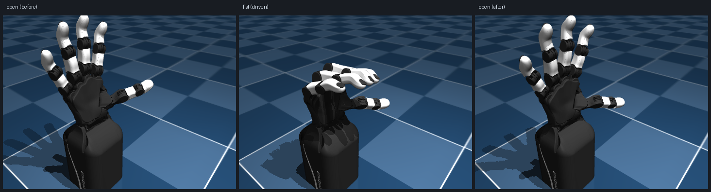

# orca-link

把本项目 [finger-motion-replay](../README.md) 的视觉采集接到 [ORCA Hand](https://github.com/orcahand/orca_core) 上。

你的视觉主端每帧算出 21 个手部关键点与五指屈曲角，本来只推给 Minecraft 的 CC:Tweaked。
这一层把同一份数据接到真机灵巧手（或它的仿真/内存 mock）上。

```
capture.html ──POST /update──▶ orca-link ──┬─ 关节角仿射映射 ──▶ orca_core（含 MockOrcaHand）
                 （你现有的 payload）        └─ HandFrame/gRPC ──▶ orca_teleop 的重定向器
```

---

## 快速开始

```powershell
# 1) 环境（Python 3.12：orca_teleop 限定 <3.13，且 grpcio 1.62 / protobuf 4.25 要对齐）
uv venv --python 3.12 .venv
uv pip install --python .venv\Scripts\python.exe -e <ORCA_LINK_ORCA_ROOT>\orca_core-upstream `
    grpcio==1.62.3 grpcio-tools==1.62.3 protobuf==4.25.9 setuptools

# 2) 生成 gRPC 桩（从 orca_teleop 的 proto 原件，保证线上格式一致）
.\.venv\Scripts\python.exe gen_proto.py

# 3) 自检：映射 + gRPC 回环 + MockOrcaHand 端到端，应 28 项全绿
.\.venv\Scripts\python.exe verify.py

# 4) 起桥接（默认 print sink，只打印不驱动硬件）
.\.venv\Scripts\python.exe orca_bridge.py --sink print
```

另开一个终端，把一帧推给它：

```powershell
$body = '{"hand":true,"source":"webcam-mediapipe","fingers":{"index":{"flex":37.8,"mcp":14.2,"pip":22.6,"dip":19.3}}}'
Invoke-RestMethod -Uri http://127.0.0.1:8766/update -Method Post -Body $body -ContentType application/json
Invoke-RestMethod -Uri http://127.0.0.1:8766/orca_joints
```

---

## 机器人侧的四种 drive

`teleop_live.py` 起的是官方 `pipeline.run()`，`--drive` 决定关节目标最终去哪：

| drive | 作用 | 需要 |
|------|------|------|
| `print` | 只打印关节角 | 无 |
| `mock` | `MockOrcaHand`，内存里跑 | `orca_core` |
| `sim` | **`orca_sim` 的 MuJoCo 仿真**，有物理、会渲染画面 | `mujoco` + `gymnasium` + `orca_sim` |
| `real` | 真机（会连接、会标定、会动） | 硬件 |

```powershell
<conda env>\python.exe teleop_live.py --drive sim                  # 仿真，帧写到 sim_frames/
<conda env>\python.exe teleop_live.py --drive sim --sim-every 6    # 每 6 步存一帧
<conda env>\python.exe teleop_live.py --drive real                 # 真机
```

### 仿真实测（无硬件）

同一套链路驱动 `orca_sim` 的 v2 手，30Hz 推入"张开 → 握拳 → 张开"：



动作往返成立。注意中间那帧主要是**掌指关节在弯、远端指节偏直**——这是合成 landmark
不严谨导致的（PIP 的命令值本身只有 -10.0 → -8.7），不是重定向器的问题。

**坑 5：官方 sim sink 拼错了模型目录名。**
`OrcaHandSimSink._resolve_retarget_model_path` 找的是
`models/<version>/orcahand_<env>/config.yaml`（**下划线**），而 orca_core 里实际是
`orcahand-right`（**连字符**），于是返回 `None` 并在 `connect()` 抛 `RuntimeError`。
`teleop_live.py` 用子类覆盖该方法绕开，同时借它把渲染帧落盘（上游只在
`render_mode="human"` 时出画面，无显示器的一侧看不到）。

---

## sink 三种模式（`orca_bridge.py`，与上面的 drive 是两回事）

| sink | 作用 | 依赖 |
|------|------|------|
| `print` | 只打印映射结果，用来对表排错 | 无 |
| `orca` | 驱动 `orca_core`。默认 `mock: true` = **不碰硬件的 MockOrcaHand** | `orca_core` |
| `grpc` | 作为 publisher 把世界坐标推给 `orca_teleop` 的 `IngressServer`，由官方重定向器求解关节 | `grpcio` + `proto_gen` |

```powershell
.\.venv\Scripts\python.exe orca_bridge.py --sink orca              # MockOrcaHand，内存里跑
.\.venv\Scripts\python.exe orca_bridge.py --sink orca --real       # 连真机（会标定、会动）
.\.venv\Scripts\python.exe orca_bridge.py --sink grpc              # 推给 50051 上的 ingress
```

`sink=grpc` 需要 payload 带 `world_landmarks`；`finger-motion-replay/app.js` 已经会带（见下）。

---

## 端点

| 方法 | 路径 | 说明 |
|------|------|------|
| POST | `/update` | 收你视觉主端的原样 payload；多了 `world_landmarks` 也可以 |
| GET | `/orca_joints` | 当前 17 个关节目标 + 按 `joint_ids` 排好的数组 + sink 状态 |
| GET | `/health` | 存活探测 |
| GET | `/reset` | 回到"没有数据"状态 |

端口默认 **8766**，因为 8765 被你的 MC 中继（`bridge_server.py`）占着。两者可以同时跑。

---

## Path A：走官方重定向器（已在 Windows 上打通）

```
capture.html ──POST /update──▶ orca_bridge.py --sink grpc ──HandFrame/gRPC──▶
    orca_teleop IngressServer ──▶ AdaptiveAnalyticalRetargeter ──▶ 17 个 ORCA 关节角
```

`test_full_chain.py` 把这条链路的**两侧真实代码**串起来跑，10 项全绿。

### 为什么不能照官方 README 装

官方说 `uv sync --extra adaptive`。**这在 Windows 上必然失败**：`adaptive` 额外依赖
`pin`(Pinocchio) / `cmeel-urdfdom` / `cmeel-tinyxml2`，而这三个包**在 PyPI 上从来没有
Windows 轮子**（我查了全部历史版本，win_amd64 数量为 0）。`nlopt`、`torch`、
`pytorch-kinematics` 倒是有。

### 可用配方（`setup-teleop-env.ps1` 已实现）

1. **Pinocchio + NLopt 从 conda-forge 取**，不要走 pip。conda-forge 有
   `win-64/pinocchio-4.1.0-py312h2d15979_1.conda`，与 pip 的 `pin 4.1.0` 同版本号。
2. 其余依赖照常 pip：`torch`（用 CPU 索引，Windows 上 PyPI 默认给 CUDA 版）、
   `pytorch-kinematics`、`grpcio`、`protobuf<5`。
3. **`orca_teleop` 本体用 `pip install --no-deps`**，否则 pip 会回头去拉 cmeel 的 `pin`。
4. 设 `ORCAHAND_DESCRIPTION_DIR` 指向 orcahand_description 检出目录。

### 三个必须知道的坑

**坑 1：模型版本要用「v2 手配置 + v1 URDF」。**
`orcahand_description` 里 **v2 的 URDF/MJCF 是 CAD 命名**（`I-AP-R_d95d02d1`、
`right_i-mcp_actuator`），而重定向配置的 v2 帧表要的是 `right_index_mcp` 这类语义名——
实测 16 个关节全部找不到。**v1 的 URDF 才是语义命名**，v2 帧表要的 21 个帧名在 v1 URDF 里
全部存在。所以：

```python
AdaptiveAnalyticalRetargeter(
    hand_config_path=".../models/v2/orcahand-right/config.yaml",   # v2 配置
    urdf_path=".../orcahand_description/v1/models/urdf/orcahand_right.urdf",  # v1 URDF
    config_path="configs/adaptive_analytical_orca_windows.yaml",
)
```

注意 `urdf_path=None` 时它按 `model_version` 去拼 `<base>/v2/models/urdf/...`，所以 v2 配置
**必须显式传 `urdf_path`**。

**坑 2：上游的 `joint_name_aliases` 方向是反的。**
它写的是 `{thumb_pip: thumb_cmc}`，但 alias 的语义是「配置关节名 → URDF 关节名后缀」。
v1 配置本身就叫 `thumb_pip`，套上这条反而去找 `right_thumb_cmc`；v2 配置叫 `thumb_cmc`，
键对不上、alias 不生效，也去找 `right_thumb_cmc`——**两种组合都差这一个关节**。
[configs/adaptive_analytical_orca_windows.yaml](configs/adaptive_analytical_orca_windows.yaml)
把它改成 `{thumb_cmc: thumb_pip}` 即可打通。

**坑 3：conda 的 OpenMP 会和 torch 撞。**
报 `OMP: Error #15: Initializing libomp.dll, but found libiomp5md.dll already initialized`
并直接终止。这是 conda(pinocchio/nlopt) + pip(torch) 混装的代价。设
`KMP_DUPLICATE_LIB_OK=TRUE` 可绕过（必须在 import torch/nlopt/pinocchio **之前**设）。
想彻底避免就得让 nlopt 走 pip、并避免 pinocchio 拉 mkl。

### 坑 4：重定向配置必须是纯 ASCII（上游默认配置在中文 Windows 上直接报错）

`adaptive_analytical.py` 用 `open(path)` 读配置，**没指定 `encoding`**。中文 Windows 的
首选编码是 **cp936(GBK)**，于是：

- **上游自带的 `adaptive_analytical_orca.yaml` 本身就加载不了**——它含一个 em-dash，实测
  `'gbk' codec can't decode byte 0x94 in position 2037`。
- GBK 解 UTF-8 字节是**按位置对齐**的，所以这个错误时隐时现：同一个文件多写几行注释，
  字节偏移一变，就从"能读"变成"报错"。

[configs/adaptive_analytical_orca_windows.yaml](configs/adaptive_analytical_orca_windows.yaml)
是 **0 个非 ASCII 字节**的。改它时请保持，否则装配会在 `yaml.safe_load` 上炸掉。

### 怎么用你的摄像头跑起来（三个终端）

```powershell
# 终端 1：机器人侧常驻（官方 pipeline）。先 print/mock 确认无误再换 real
D:\tools\miniconda\envs\orca-teleop\python.exe teleop_live.py --drive mock

# 终端 2：桥接，把帧经 gRPC 推给机器人侧（默认 localhost:50051）
D:\tools\miniconda\envs\orca-teleop\python.exe orca_bridge.py --sink grpc

# 终端 3：你的视觉主端
cd ..   # 回到项目根
python -m http.server 8000     # 浏览器开 http://localhost:8000/capture.html
```

**捕获页要发到 8766，不是 8765。** 把 `app.js` 的 `BRIDGE_URL` 改成
`http://127.0.0.1:8766/update`（一行）。`bridge_config.yaml` 里默认的
`forward_to: http://127.0.0.1:8765/update` 会把原始 payload 再转发给你的 MC 中继，
于是**同一只手同时驱动 MC 机械手和 ORCA 灵巧手**。

转发是异步的（独立线程 + 有界队列，满则丢最旧），对方没起也不影响主链路；
`GET /orca_joints` 里有 `forwarded` / `forward_failed` / `forward_error` 计数。

没有摄像头时也能验证整条链路：

```powershell
# 终端 1 起 teleop_live.py --drive mock，终端 2 起 orca_bridge.py --sink grpc，然后
python drive_synthetic.py --seconds 9 --hz 30
```

实测（30Hz、270 帧全部送达、204 次关节目标，张开 → 握拳 → 张开）：

```
[live] #1     in·mcp=  9.2   mi·mcp= 12.1  ...
[live] #65    in·mcp= 83.1   mi·mcp= 89.1  ...   <- 握拳
[live] #173   in·mcp=  9.1   mi·mcp= 12.1  ...   <- 张开
```

### 其它行为特征

- **前 30 帧重定向器返回 `None`**，是自动尺度标定期，机械手保持 `init_joints()` 姿态不动。
- 返回的 `OrcaJointPositions` 内部顺序是**四指在前、`wrist` 在最后**，与
  `config.joint_ids`（`wrist` 在最前）**不一致**。用 dict 无所谓；要拼 ndarray 请务必走
  `action.as_array(hand.config.joint_ids)`。
- `orca_teleop` 的 gRPC 桩优先于本目录 `proto_gen/`：两者同时注册会报
  `duplicate symbol 'orca_teleop.HandFrame'`，代码里已做优先级处理。

### 质量说明（重要）

`test_retargeter.py` / `test_full_chain.py` 用的是**我手工合成的 landmark**，解剖学上不严谨。
实测结果是四指 MCP 对「握拳」有 +68~77° 的强响应、外展 +15~17°，但 **PIP 几乎不动、
拇指顶在 ROM 下界**。这更像是合成姿势的问题，**不能据此判断重定向质量**。
要评估质量必须喂真实摄像头数据（你浏览器里的 `worldLandmarks`，或 ORCA 自带的
`ingress/mediapipe/publisher.py`）。


---

## 映射怎么定的

真值来自 ORCA 的 `config.yaml`（`joint_ids` / `joint_roms` / `neutral_position`），不是硬编码；
读不到时才用内置的 v2 右手副本兜底。

```
目标 = neutral + gain × (视觉屈曲角 / 满屈曲角) × (rom_max − neutral)      再夹到 [rom_min, rom_max]
```

| 视觉输入 | ORCA 关节 |
|---|---|
| `thumb.mcp` (CMC) | `thumb_cmc` |
| `thumb.pip` (MCP) | `thumb_mcp` |
| `thumb.dip` (IP) | `thumb_dip` |
| `{index,middle,ring,pinky}.mcp` | `*_mcp` |
| `{index,middle,ring,pinky}.pip` | `*_pip` |
| 四指的 `.dip` | **丢弃**（ORCA v2 四指没有 DIP 关节） |
| 五指外展、腕 | 视觉算不出 → 保持中立位 |

**拇指键名陷阱**：payload 里拇指的 `mcp/pip/dip` 实际是 **CMC/MCP/IP**，映射层按语义修正了。

调参在 [bridge_config.yaml](bridge_config.yaml)：`full_flexion_deg`（多少度算满屈曲）、`gain`、
`max_step_deg`（单帧限速，默认 25°，防甩手）、`abduction_from_landmarks`（用世界坐标估外展，
实验性、默认关）、逐关节覆盖。

---

## 前端需要的那 3 行

`finger-motion-replay/app.js` 原本只取 `result.landmarks`（归一化图像坐标），而真机重定向要的是
`result.worldLandmarks`（**米制、腕部相对**），两者不可互换。已加入（+12 行，纯增量）：

```js
const world = result && result.worldLandmarks ? result.worldLandmarks[0] : null;
lastWorldLandmarks = raw && raw.length >= 21 && world && world.length >= 21 ? world : null;
// ...
if (ang && lastWorldLandmarks) {
  payload.world_landmarks = lastWorldLandmarks.map((p) => [p.x, p.y, p.z]);
}
```

MC 链路不受影响：`bridge_server.py` 只读 `fingers`，多这个键无副作用（已实测）。

---

## 文件

| 文件 | 作用 |
|------|------|
| `orca_hand_map.py` | 映射核心，纯逻辑，可单独 import |
| `orca_bridge.py` | HTTP 服务 + 三种 sink |
| `bridge_config.yaml` | 映射与桥接参数 |
| `gen_proto.py` | 从 orca_teleop 的 proto 原件生成 gRPC 桩 |
| `verify.py` | 28 项自检 |
| `proto_gen/` | 生成的桩（可重新生成） |

## 注意

- `verify.py` 的第 2 段会加载 **orca_teleop 真实的 `ingress/server.py` 原件**，但通过
  预注册包模块绕开了它的 `__init__.py`（那个会 import 整条 pipeline，拖进 torch）。
- 重定向器（路径 A）**前 30 帧返回 `None`** 用于自动尺度标定，机械手保持不动，不是卡死。
- 上游 `orca_teleop` **没有 LICENSE 文件、issues 已关闭**，用于商业场景前请自行确认授权。
