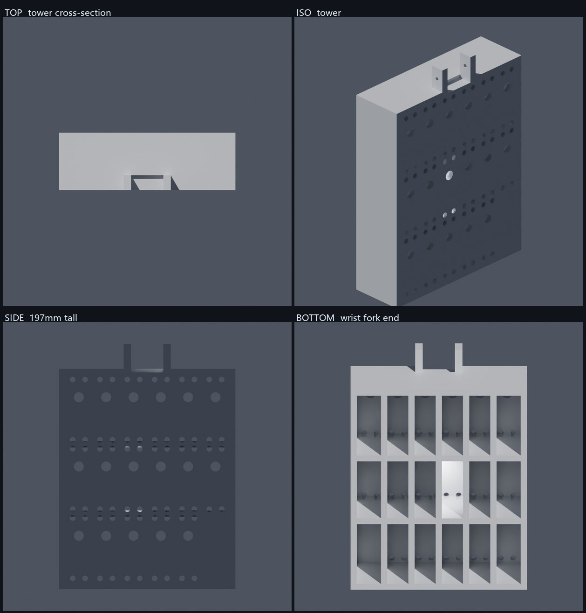

# PWM 前臂设计（v3 · 塔式）

为 **17 颗 ¥25 级 PWM 舵机**（40×20×40 mm）设计新前臂。

- 架构文档：[ORCA-自主架构-PWM方案.md](../../../docs/ORCA-自主架构-PWM方案.md)
- v1（实心壳）/ v2（平板）均已作废，见文末记录

## v3 当前状态（用户选定「方案 B」）



`gen_forearm_v3.py` 生成，**立塔式**：

| 项 | 值 |
|---|---|
| 塔体 | **142.0 (X) × 46.0 (Y) × 177.1 (Z) mm** + 顶部腕叉 20 mm |
| 总外廓 | **142.0 × 46.0 × 197.1 mm** |
| 布局 | **6 列 (X) × 3 排 (Z) = 18 格**，用 17（16 指 + 1 腕），空 (0,0) |
| 栅距 | X **22.0** / Z **55.7** mm |
| 舵机朝向 | **输出轴统一 +Y** —— 线轴全部在同一侧面，腱绳从该侧汇出 |
| 腔深 | 42 mm（舵机 H=40 + 2） |
| 安装板 | +Y 面，17 轴孔 Ø8 + **68 安装孔 Ø4.5** |
| 自检 | 水密 ✅ / 法线一致 ✅ / 17-17 轴孔 ✅ / 68-68 安装孔 ✅ |
| 体积 / STL | 444 cm³ / 868 KB |

### 为什么是 6×3 而不是 3×2×3

v2 漏算了一个量：**安装孔在耳朵上，距格心 ±24.25**（跨距 48.5），
所以沿**舵机长度方向**的实际栅距是含耳总长 **54.5 mm**，不是 40 mm。
按 40 排会过密、耳朵互相干涉。

按 54.5 重算，方案 B 的正确形态是：
- X 向排舵机**宽度** 20 → 6 列 = 132 mm
- Z 向排舵机**长度** 54.5 → 3 排 = 163 mm
- Y 向是舵机高度 40（= 轴长 = 塔深）

得到一个 **142 × 46 × 177 mm 的立塔**（原塔是 88 × 122 × 91，新塔更高更窄）。


| 体积 | 215.3 cm³，STL 857 KB |

**结构**：顶板 + 两侧半开矮墙（14 mm）+ 行间纵向梁 + 列间横向梁（6 mm 宽）
+ 腕叉。沿用原 ORCA 的「框架笼」思路，而不是 v1 的实心四壁。

## 已确认的边界条件（2026-11）

用户已打印 **只打了手指和手掌**（P6 Carpals + P7 Fingertips）。其余全部未打印，
因此腕部结构、前臂、线轴、齿轮都可以重新设计。

**唯一必须严格配合的，是已打印的手掌（`R-Carpals` / `CORE-R`）的腕关节接口。**

### 腕关节：来自 MJCF 运动学树的权威数据

来源 `orca_sim/src/orca_sim/models/v2/mjcf/orcahand_right_body.xml`：

```
<body name="right_TopTower-Model_4a80d30e" ...>          <- 原前臂顶部
  <body name="right_R-Carpals_8d1f1041"
        pos="-0.0018770780631086163 0.005000000000000039 0.08950000067055244"
        quat="-0.7071067811865475 0.0 0.0 0.7071067811865495">
    <joint name="right_wrist"
           pos="0.004999999999999997 0.0018770780631086805 -0.049500000670552255"
           axis="-0.9999999999999963 0 0"
           range="-1.1344640137963142 0.6108652381980153" />
```

换算到 **前臂（TopTower）坐标系**（carpals 的 quat 是绕 Z 轴 −90°）：

| 量 | 值 |
|---|---|
| **腕关节轴心位置** | **(0, 0, +40.0) mm** —— 居中、高出前臂原点 40 mm |
| **腕关节轴向** | **(0, 1, 0)**，即**沿 Y（左右）方向**的水平轴 |
| 关节行程 | **−65° … +35°**（与 `config.yaml` 的 `joint_roms.wrist` 一致） |

> 这条是硬约束：新前臂必须把腕轴放在这个位置/方向，否则已打印的手掌装不上。

### 舵机几何（新 PWM 舵机，依据外形尺寸图）

| 项 | 值 | 设计含义 |
|---|---|---|
| 本体 | 40(L) × 20(W) × 40(H) | 栅格行距/列距 |
| 含耳总长 | 54.5（每侧 7.25） | 需要 ≈56 mm 的栏距 |
| 安装孔 | **4 × Ø4.4**，沿宽 ±5、沿长跨距 48.5（±24.25） | 68 个 Ø4.5 过孔 |
| 输出轴 | Ø7，轴心距轴端面 10 mm | 轴孔 Ø8，位置 = 格心 −10 mm |
| 重量 | 55 g × 17 = **935 g** | 比 XC330 方案 +544 g |

### 原前臂结构（实测，供参考）

`ForeArmStructure_Feetech.stl`，88.0 × 122.1 × 91.0 mm，是**栅格框架（frame cage）**：

| 方向 | 位置 (mm) | 间距 |
|---|---|---|
| 5 排 | 52.4 / 34.6 / 11.4 / −11.7 / −35.1 | ≈23.2 |
| 3 列 | −28.5 / −0.1 / 25.6 | ≈28.1 |

框架的「栏距」就是腔位尺寸。原舵机 HLS3915 是 20×34×23（15.6 cm³），
新舵机 40×20×40（32.0 cm³，含耳 43.6）≈ **2–2.8 倍**，所需栏距 ≈56 mm ≫ 23.2 mm。

**结论：栅格无法局部放大，必须按新间距重建；但腕关节接口一寸不动。**

---

## v2 设计要点（下一步）

**保留**
- 腕关节：轴心 (0, 0, 40)，轴向 (0,1,0)，行程 −65°…+35°
- 与已打印掌骨的配合关系（轴承座 Ø13、销 Ø3 → 见 ASSEMBLY_ADDENDUM）
- 腱绳在掌骨侧 32 条 PTFE 通道的对接位置

**重建**
- 栅格框架：按新舵机 56 mm 栏距重排（候选：2 排 × 8 列 + 1 腕）
- 顶板：17 轴孔 Ø8 + 68 安装孔 Ø4.5

**待定/待测**
- 手掌侧腱绳入口的实际位置（需量 `R-Carpals` / `CORE-R` 的近端面开口）
- 腕驱动方式（原设计是 GT2 同步带；新方案可保留或改直驱）
- 线轴花键是否匹配新舵机（**未确认，最高风险项**）

---

## 工具

| 文件 | 作用 |
|---|---|
| `gen_forearm.py` | v1 参数化生成器（trimesh + manifold3d），**孔位参数与自检方法可直接复用** |
| `render_preview.py` | Blender 渲染四视图（Cycles CPU，含 clip 与相机朝向修正） |
| `measure_bays.py` | STL 射线穿透掩膜工具（量化任意 STL 的内部腔位布局） |

```bash
python gen_forearm.py                    # 生成 STL + 自检
python gen_forearm.py --check            # 只自检
blender --background --factory-startup --python render_preview.py
```

## v1 记录（外形作废）

v1 是 211.2 × 119.0 × 44.0 mm 的「浴缸式」实心壳，17 个舵机格。
**方向作废**：丢掉了原模型的框架结构与腕部接口。保留价值：

- 舵机孔位参数（4 孔/颗、轴偏移 10 mm）与计算正确
- 自检方法（体积核算 0.053%、纯 numpy 逐孔判定）可复用
- 已修通 4 个工具链坑：Blender EXACT 布尔在对称列静默漏切 → 换 manifold3d；
  刀具深度不足留盲孔；毫米单位撞 `clip_end=100`；相机 `to_track_quat(-Z, d)` 朝外看导致空图

v1 结果：水密、17/17 轴孔、68/68 安装孔、体积误差 0.053%。
