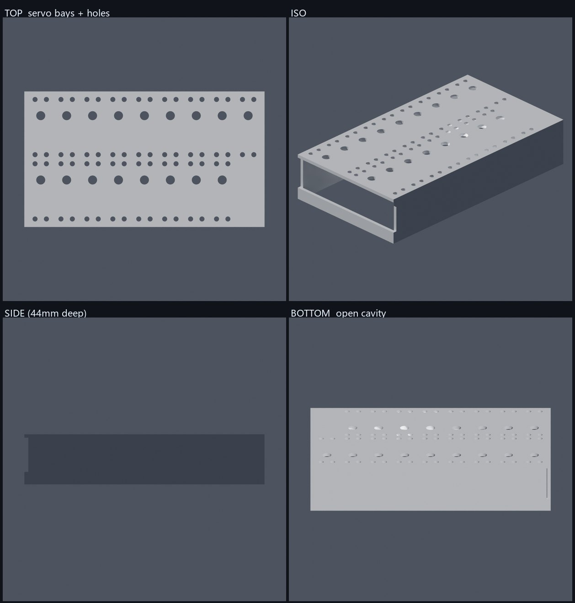

# PWM 前臂 v1（参数化生成）

自主路线的机械起点：为 **17 颗 ¥25 级 PWM 舵机**（40×20×40 mm）设计的新前臂壳。

对应设计文档：[ORCA-自主架构-PWM方案.md](../../../docs/ORCA-自主架构-PWM方案.md)



---

## 这是什么

一块**顶板 + 四壁**的浴缸式壳体，倒扣打印（顶板贴床面）：

- 17 颗舵机挂在顶板下方，输出轴朝上穿过顶板
- 布局 **9 列 × 2 行 = 18 格**：16 格手指舵机 + 1 格腕舵机（+X 端），空 1 格
- 顶板开 **17 个轴孔 Ø8** + **68 个 M4 安装孔 Ø4.5**（每颗舵机 4 个）
- +X 壁开腱绳出口槽 120×30 mm
- 底部敞开（v1 不做底盖）

外廓 **211.2 × 119.0 × 44.0 mm**，体积 138.6 cm³。

## 舵机几何来源

依据用户提供的**外形尺寸图**（鑫辉 20KG 数字舵机）：

| 项 | 值 | 用在哪 |
|---|---|---|
| 本体 | 40(L) × 20(W) × 40(H) | 格距 CELL_X=22.8 / CELL_Y=56.5 |
| 含耳总长 | 54.5（每侧外伸 7.25） | 格距 |
| 安装孔 | **4 × Ø4.4 贯穿** | 68 个 Ø4.5 过孔 |
| 孔间距 | 沿宽 10 / 沿长跨距 48.5 | 孔位（±5 / ±24.25） |
| 输出轴 | Ø7，轴心距轴端面 10 | 轴孔 Ø8，位置 = 格心 − 10mm |
| 腔深 | 本体高 40 + 1 | CAVITY = 41 |

> ⚠️ 我最初把 `4-Ø4.4` 读成"每颗 2 个孔"，实际是**每颗 4 个**（每侧耳朵 2 个）。
> 孔间距 10 是**沿宽度方向**，48.5 是**沿长度方向**的跨距。

## 怎么跑

```bash
# 生成 STL + 自检报告 + JSON
python gen_forearm.py

# 只自检不写文件
python gen_forearm.py --check

# 渲染预览（需 Blender；会覆盖 out/*.png）
blender --background --factory-startup --python render_preview.py
```

改设计只需要动 `gen_forearm.py` 顶部的参数块：舵机尺寸、`CLEAR`、`WALL_T`、
`PLATE_T`、`COLS/ROWS`、`WRIST_CELL`、`EMPTY_CELL`、`SHAFT_HOLE_D`、`SLOT`。

## 自检（每次生成都跑）

当前 v1 结果：

| 检查 | 结果 |
|---|---|
| 水密 | ✅ True |
| 法线一致 | ✅ True |
| 顶点 / 面 | 8206 / 16752 |
| 外廓 | 211.2 × 119.0 × 44.0 mm |
| **轴孔** | **17/17 通** |
| **安装孔** | **68/68 通** |
| 体积 vs 预测 | 138560 vs 138634 mm³（差 **0.053%**） |

逐孔判定用纯 numpy：若存在三角形在顶板 z 区间内、其 XY 投影盖住孔心，
则判定该孔被实心材料挡住。不用射线（trimesh 的射线模块依赖 rtree）。

---

## 实现过程中踩过的四个坑（都已修）

1. **Blender 的 EXACT 布尔在对称位置漏切**
   第一版在 x=0 那一整列漏了 2 个轴孔（静默失败，只从几何数量看得出来）。
   改用 **trimesh + manifold3d** 做 CSG：纯 Python、可逐步校验、失败会报错。

2. **刀具深度不够**
   早期刀深只有 `PLATE_T + 2` 但居中在板厚中间，两端各差 0.5 mm → 留下盲孔。
   现在 `CUT_H = PLATE_T + 10`，居中于板厚中点，上下都贯穿。

3. **Blender 里毫米单位撞上默认裁剪面**
   模型是毫米（211 单位），相机默认 `clip_end=100` → 物体整体被裁掉。
   需显式 `clip_start=1 / clip_end=10000`。

4. **相机朝外的旋转 bug**
   `d.to_track_quat("-Z","Y")` 把 -Z 对齐到 d，即相机**背离原点看**，渲染全空。
   必须用 `(-d).to_track_quat("-Z","Y")`。表现为前景像素 0.0%——所以
   渲染脚本必须自检前景占比，不能只看文件大小。

---

## v1 的已知缺口（下一版要解决）

- [ ] **腕部接口**：+X 端只开了腱绳槽，还没和 ORCA 的 `WristStructure` 对接
- [ ] **腱绳导向**：17 条腱从线轴到腕部需要 PTFE 通道/导向孔，v1 没有
- [ ] **线轴接口**：`BaseSpool` 是按 HLS 的 25T/OD4.95 或 OD5.9 做的，
      新舵机花键规格未确认 —— **花键不匹配则线轴要重做**
- [ ] **底盖**：v1 底部敞开，舵机与线束裸露
- [ ] **散热/减重**：侧壁尚无通风槽与减重孔
- [ ] **前臂到手腕的过渡**：整机装配关系未定
- [ ] **打印验证**：尚未实际打印，公差（Ø4.5 过孔、腔深 41）未经验证
