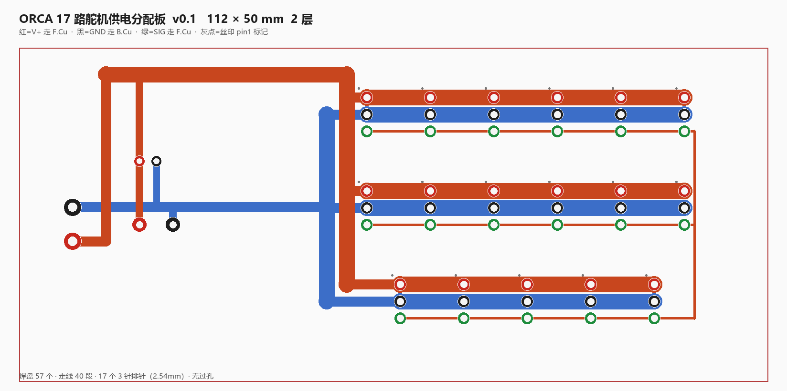

# ORCA 17 路舵机供电分配板（v0.1）

板子即代码：`gen_board.py` 是唯一真值，直接产出嘉立创可消费的 Gerber + Excellon + 预览图。

```
python gen_board.py      # 生成 out/ 下全部文件 + 跑自检
```



---

## 为什么不是 KiCad 工程

原计划装 KiCad 用 `kicad-cli` 出图，实测本机网络下**不可行**：

| 途径 | 结果 |
|---|---|
| `downloads.kicad.org` 官方 CDN | 连得上但**限速 20 KB/s**（1.2 GB 要 20 小时） |
| 清华源 `mirrors.tuna.tsinghua.edu.cn/kicad` | 目录 200，但 `kicad-*.exe` 返回 **403**（只镜像元数据） |
| 阿里云 `mirrors.aliyun.com/kicad` | 同样 **403** |
| `winget install KiCad.KiCad` | 包地址在 GitHub Releases，而 `github.com:443` 被重置 |

所以改成**直接生成 Gerber**。Gerber（RS-274X）本身就是纯文本格式，嘉立创接受
Gerber ZIP，甚至比 EasyEDA 工程更通用。

**代价（必须知道）**：这不是 KiCad 工程，打不开也改不了走线。要改就改
`gen_board.py` 里的参数后重跑。**没有工业 DRC** —— 只有本文件自带的自检。

---

## 这块板解决什么问题

17 个舵机如果**串着**供电（一个接一个），末端必然欠压：线阻累积 + 多级压降，
表现是远端手指没力、通信随机出错。这块板改成**星形**：

- `V+` 一根纵向母干（F.Cu）分到三排，每排一根排干
- `GND` 一根纵向母干（B.Cu）分到三排
- `SIG` 在板上串接成菊花链（信号本来就可以串）

**两层内完全不交叉、不用一个过孔** —— 因为 THT 焊盘天然两面导通，V+ 走顶层、
GND 走底层即可。

---

## ⚠️ 载流能力：这块板不是 15 A 板

这是本设计**最重要的一条限制**，先说清楚：

| 项 | 数值 |
|---|---|
| 母干/排干宽度 | **2.4 mm**（不能更宽 —— 见下） |
| 17 舵机按默认限流 900 mA 的总电流 | **15.3 A** |
| 2.4 mm × 35 µm(1oz) 大致可持续 | **3–4 A**（温升可接受范围内） |
| 2.4 mm × 70 µm(2oz) 大致可持续 | **6–8 A** |

**为什么不能更宽**：排针是 2.54 mm 间距。排干加到 3.5 mm 时，自检实测**与相邻焊盘
重叠 0.11 mm**（直接短路）—— 这是自检抓出来的，不是估的。所以 2.4 mm 是几何上限。

**结论与做法**（二选一或并用）：

1. **下调单舵机电流上限**，使总电流落在板子能力内。例如 17 × 280 mA ≈ 4.8 A，
   配合 1 oz 铜即可。`orca_core` 的 `config.yaml` 里 `max_current` 可配。
2. **下单时选 2 oz 铜**（嘉立创支持加价选项），可到约 6–8 A。

要做真正 15 A 的版本，得上**铺铜（plane）**或 4 层板 —— 那需要真正的 EDA 做 clearance
自动避让，本生成器不做（见 TODO）。

---

## 电气设计决策（每条都写了理由）

| 决策 | 理由 |
|---|---|
| 输出接插件用 **2.54 mm 3 针排针** | 与 ORCA 官方接线板的 2.54 mm 3 针口径一致（官方 BOM 料号 `C541850`） |
| **保险丝不在板上** | 不必为某种保险丝座编一个我无法核实的机械封装。保险丝做在供电线上（串联 ATO/5×20 座） |
| **没有防反接** | 加 P-MOSFET 理想二极管需要具体器件选型（低 Rds(on)、15 A 级），留给 v0.2。**上电前必须自己核对极性** |
| C1 **1000 µF / ≥35 V** | 17 个舵机同时换向的电流突变靠它吸收，否则母线电压塌陷会触发欠压复位 |
| C2 **100 nF** | 高频旁路 |
| 无过孔 | THT 焊盘两面导通，V+/GND 各占一层即可 |

---

## 元件清单

| 位号 | 规格 | 数量 |
|---|---|---|
| J1 | 5.08 mm 2 位螺钉端子（VIN+ / VIN−） | 1 |
| C1 | 电解 1000 µF / ≥35 V，D10 P5 | 1 |
| C2 | 陶瓷 100 nF，P2.54 | 1 |
| J2–J18 | 2.54 mm 3 针立式排针 | **17** |

---

## 下单

把 `out/orca-servo-dist-v0.1-gerber.zip` 直接上传到嘉立创 / JLCPCB：

- 层数 **2**，板厚 **1.6 mm**，铜厚 **1 oz（想跑更高电流选 2 oz）**
- 表面处理 HASL（有铅无铅都行）
- 尺寸 112 × 50 mm
- 阻焊/丝印：默认

板子**没有安装孔**（v0.1 缺口，见 TODO）。固定靠端子与排针即可，或自己打孔。

---

## v0.1 已知缺口

- [ ] **丝印没有文字**（没有位号/极性标记文字）—— Gerber 文字要描边字体，未实现；
      只有每排 pin1 一个圆点标记
- [ ] **没有安装孔**
- [ ] 没有防反接
- [ ] 保险丝不在板上
- [ ] 没有铺铜 → 载流能力受限（见上）
- [ ] 自检只覆盖：越界、异网焊盘间距、走线穿异盘、环宽。
      **不覆盖**：走线夹角、热焊盘、阻抗、制造最小环宽/最小间距的工艺上限

---

## 自检在做什么

`self_check()` 是这份生成器唯一的正确性保障，它检查：

1. 焊盘是否越过板边安全区（1.6 mm）
2. 异网焊盘之间的净间距是否 ≥ 0.25 mm
3. 走线是否穿过/贴近异网焊盘（点到线段距离）
4. 环宽是否至少比钻孔大 0.15 mm

它**抓过两个真短路**（V+ 输入竖线穿过 J1 的 GND 盘 −3.05 mm；3.5 mm 排干与邻盘
重叠 0.11 mm），所以不是摆设 —— 但它不等于 DRC。
